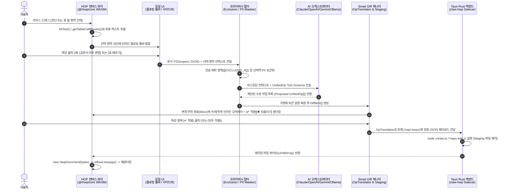

# HOP-Claw (로컬 설치형 AI HWP 협업 데스크톱 앱) 상세 구현 가이드
> **문서 목적**: 본 문서는 [`local_ai_hwp_spec.md`](./local_ai_hwp_spec.md)의 기능 명세(PRD)를 실제 작동하는 프로덕션 데스크톱 애플리케이션으로 구현하기 위해 **아키텍처 결정 사항, 디렉토리 구조, 핵심 모듈 코드 설계, 데이터 스키마, 예외 처리 및 단계별 작업 순서(Step-by-Step)**를 구체화한 **후임 개발 에이전트 전용 작업 지침서**입니다.

---

## 0. 후임 에이전트를 위한 핵심 원칙 (Golden Rules)

작업 시작 전 아래 5가지 기술적 결정 사항을 반드시 숙지하십시오. 임의로 우회하거나 재작성하면 한컴오피스 호환성이 깨집니다.

1. **`claw-hwp` 엔진 재작성 절대 금지 (As-Is Sidecar 활용)**
   - 로컬에 이미 검증된 `claw-hwp` 스크립트 군(`create.js`, `cell-patch.js` 549KB, `hwpx-edit.js` 285KB, `extract_text.js`, `cell-inspect.js`, `secure-fill.mjs`)이 존재합니다(경로: `C:\Users\choij\.gemini\config\skills\hwp\scripts\`).
   - 이 스크립트들은 한컴독스(웹) 및 한컴오피스(데스크톱)의 까다로운 바이너리/XML 규격(`PARA_LINESEG` 제거, `BorderFill` 리매핑, `hp:switch` 문단 여백 보존, `markpenBegin` 하이라이트 등)을 수백 번의 검증 끝에 구현한 결과물입니다.
   - **결정**: 이 로직을 Rust나 프론트엔드 JS로 재작성하지 말고, 프로젝트의 `resources/claw-hwp/`에 번들링한 뒤 **Tauri Rust 백엔드에서 Node.js 워커 프로세스(`stdin` JSON 입력 $\rightarrow$ `stdout` JSON 출력)**로 호출하십시오.
2. **뷰어/좌표 계산은 인메모리 `@rhwp/core` WASM, 파일 저장은 `claw-hwp` 이원화 (Dual-Engine 패턴)**
   - **화면 렌더링·마우스 드래그 선택·바운딩박스 계산**: 프론트엔드 WebView 내 `@rhwp/core` WASM(`HwpDocument`)이 담당합니다 (`renderPageToCanvas`, `hitTest`, `getSelectionRects`, `getTableCellBboxes`).
   - **실제 파일 수정(Mutation)**: `@rhwp/core`의 `exportHwp()`를 대용량 기존 문서에 직접 쓰면 한컴독스에서 파일이 손상될 수 있습니다. 따라서 모든 수정은 **AI가 생성한 명령어(`UnifiedOp[]`)를 `claw-hwp`의 `create.js`(.hwp raw-patch) 또는 `hwpx-edit.js`(.hwpx XML patch)로 실행**한 뒤, 수정된 바이트를 다시 `@rhwp/core` WASM 뷰어로 리로드하여 렌더링합니다.
3. **원본 보호를 위한 Shadow Staging 파일 아키텍처**
   - 사용자가 열람 중인 원본 파일(`report.hwp`)을 AI가 직접 덮어쓰면 **Smart Diff (부분 수락/반려)**와 **실행 취소(Undo)**가 불가능합니다.
   - 문서를 열 때 `.hop-staging/` 임시 폴더에 스냅샷 사본을 생성하고, 개별 변경 사항(`DiffItem`)이 수락될 때마다 스테이징 파일에 패치를 적용하며, 사용자가 `Ctrl+S`(저장)를 누를 때만 원본 경로에 원자적 교체(Atomic Rename)를 수행합니다.
4. **`.hwp`와 `.hwpx`의 표/문단 주소 체계 차이를 흡수하는 `OpTranslator` 계층 필수 구현**
   - `.hwp`(`create.js`)는 표를 `{ section, para, control }` 3원 좌표로 지목하고, `.hwpx`(`hwpx-edit.js`)는 표를 문서 순서 기반의 단일 인덱스 `{ table }` (0-based)로 지목합니다.
   - AI 모델과 프론트엔드 UI가 파일 포맷 차이를 신경 쓰지 않도록, 중간 계층인 **`OpTranslator`**가 단일 표준 스키마(`UnifiedOp`)를 각 포맷 전용 페이로드로 자동 변환해야 합니다.
5. **`@rhwp/core` WASM 렌더링 불변 규칙 준수**
   - WASM 초기화 **이전에** 반드시 `globalThis.measureTextWidth`를 `<canvas>` 2D 컨텍스트 기반으로 등록해야 합니다.
   - 페이지 렌더링 루프에서 **모든 페이지의 `doc.getPageInfo(i)`를 먼저 호출한 뒤** `doc.renderPageToCanvas(i, canvas, scale)`를 호출해야 합니다(교차 호출 시 Rust 내부 Borrow Panic 발생).
   - 각 페이지의 `renderPageToCanvas(i, ...)` 직후 반드시 **`doc.getPageTextLayout(i)`**를 호출하여 Rust 내부 페이지 Borrow를 해제하고, 반환된 레이아웃 JSON을 캐싱해야 합니다.

---

## 1. 전체 시스템 아키텍처 및 기술 스택 결정

### 1.1 기술 스택 (Tech Stack)
| 계층 | 채택 기술 | 선정 이유 및 역할 |
| :--- | :--- | :--- |
| **Desktop Shell & IPC** | **Tauri v2 (Rust)** | `golbin/hop`의 기본 프레임워크. OS 파일 연결(`.hwp`, `.hwpx`), 네이티브 파일 시스템 제어, Node.js 사이드카 프로세스 실행, 로컬 보안 저장소 제공 |
| **Frontend Framework** | **React 19 + TypeScript + Vite + TailwindCSS** | `hop` 뷰어 캔버스 위 인라인 플로팅 툴바, Smart Diff 오버레이, 우측 AI 채팅 사이드바 구현 |
| **State Management** | **Zustand + Immer** | 문서 바이트 상태, 선택 영역(`SelectionState`), Diff 큐(`DiffItem[]`), 제외 영역(`ExcludedRegion[]`), 채팅 히스토리 관리 |
| **In-Memory Viewer Core** | **`@rhwp/core` (WASM)** | 로컬 캔버스 렌더링, 마우스 좌표 $\leftrightarrow$ 문단/셀 히트테스트(`hitTest`), 선택 영역 사각형 추출(`getSelectionRects`, `getTableCellBboxes`) |
| **Document Mutation Core** | **`claw-hwp` (Node.js 20+ Sidecar)** | `create.js` + `cell-patch.js` (`.hwp` 바이트 레벨 인플레이스 패치), `hwpx-edit.js` (`.hwpx` OWPML XML 패치), `extract_text.js` (구조/마크다운 추출), `secure-fill.mjs` (개인정보 제로컨텍스트 채우기) |
| **Diff Engine** | **`diff-match-patch`** | 변경 전/후 문장 및 셀 텍스트의 단어/음절 단위 비교(취소선/하이라이트 렌더링용) |
| **Multi-File Parsers** | **`xlsx`(SheetJS), `pdfjs-dist`, `extract_text.js`** | 사이드바에 드래그 앤 드롭된 로컬 엑셀, PDF, 외부 HWP 파일을 클라우드 업로드 없이 로컬에서 즉시 마크다운/JSON으로 파싱 |
| **AI Orchestrator** | **자체 `LLMRouter` (`aiOrchestrator.ts`) + Rust `llm_proxy.rs` (`reqwest`)** | WebView CORS 문제를 원천 차단하기 위해 모든 외부/로컬 LLM HTTP 호출은 Tauri Rust 백엔드(`llm_proxy.rs`)를 경유하며, Anthropic Claude / OpenAI / Gemini / 로컬 **Ollama (`http://127.0.0.1:11434`)**를 단일 Tool-Calling 인터페이스로 통합 (외부 AI SDK 의존성 배제) |

### 1.2 데이터 및 제어 흐름도 (End-to-End Architecture)



---

## 2. 디렉토리 및 프로젝트 구조 설계 (Project Layout)

> **부트스트랩 방식 확정 (`golbin/hop` 정품 에디터 + `claw-hwp` AI 협업 결합)**:
> 단순 읽기 전용 프리뷰어(`preview-viewer.js`)에 텍스트 박스만 얹는 간이 구현은 금지합니다. 반드시 실제 **`golbin/hop` (`studio-host` + `third_party/rhwp/rhwp-studio` + `vendor/rhwp-core` v0.8.7 WASM)** 전체 에디터 DOM 및 런타임(상단 메뉴바 `파일·편집·보기·입력·서식·쪽·표·도구`, 아이콘 리본 툴바, 서식 도구모음 `스타일·언어·글꼴·크기·줄간격·글자모양·색·문단정렬`, 가로/세로 눈금자 `#h-ruler`/`#v-ruler`, 캔버스 직접 타이핑·커서·표 셀 편집·다이얼로그)을 베이스로 탑재하고, 그 위에 **`claw-hwp` AI 협업 레이어**(좌/우 전환 가능한 AI 채팅 패널, 에이전트 실행 로그 `'문서 확인 N회, 페이지 M개 읽음, 문서 편집 K건'`, 인라인 플로팅 툴바, Smart Diff 오버레이 및 즉시 반영 토글, 다중 포맷 첨부 파서 `.docx/.xlsx/.pdf/.hwp/.hwpx`, 프라이버시 마스커)를 결합합니다. (Windows PowerShell 실행 정책 우회를 위해 패키지 매니저 명령은 반드시 `npm.cmd` / `npx.cmd`를 사용하십시오.)

```text
hop-claw/
├── resources/
│   └── claw-hwp/                        # C:\Users\choij\.gemini\config\skills\hwp\ 에서 복사해 번들링
│       ├── scripts/
│       │   ├── create.js                # .hwp 생성 및 인플레이스 raw-patch 엔진
│       │   ├── cell-patch.js            # .hwp 바이트 레벨 레코드 패처
│       │   ├── hwpx-edit.js             # .hwpx OWPML XML 원자적 편집 엔진
│       │   ├── extract_text.js          # 텍스트/마크다운 추출 및 --inspect --with-cell-text
│       │   ├── cell-inspect.js          # 표/셀 전수 조사 모듈
│       │   ├── secure-fill.mjs          # 개인정보 제로컨텍스트 서식 채우기
│       │   ├── make_seal.py             # 4글자 관인/도장 PNG 생성기
│       │   ├── templates/
│       │   │   └── hancom_native_stub.hwpx
│       │   └── vendor/
│       │       ├── rhwp/                # rhwp.js, rhwp_bg.wasm
│       │       ├── fflate/              # ZIP 압축/해제
│       │       └── cfb/                 # OLE/CFB 컨테이너 파서
│       └── themes/                      # government, corporate 등 테마 정의
├── src-tauri/                           # Tauri v2 Rust 백엔드
│   ├── Cargo.toml
│   ├── tauri.conf.json                  # resources/claw-hwp 번들 설정 및 파일 연결(.hwp, .hwpx)
│   └── src/
│       ├── main.rs
│       ├── lib.rs
│       ├── commands/
│       │   ├── mod.rs
│       │   ├── document.rs              # 파일 열기, 스테이징 복사, 원자적 저장, 스냅샷 관리
│       │   ├── claw_bridge.rs           # Node.js로 extract_text / create / hwpx-edit 실행
│       │   ├── attachment.rs            # 로컬 참조 파일(PDF/XLSX/HWP) 읽기
│       │   └── llm_proxy.rs             # CORS 우회용 로컬 Ollama / 상용 LLM HTTP 스트리밍 프록시
│       └── state.rs                     # 열려있는 문서 세션 및 임시 디렉토리 상태 관리
└── src/                                 # Frontend (React + TypeScript)
    ├── main.tsx
    ├── App.tsx                          # 메인 레이아웃 (좌/중앙: 캔버스 뷰어, 우: 접이식 AI 사이드바)
    ├── types/
    │   ├── hwp.ts                       # DocTargetAddr, TableInspectInfo, SelectionState 타입
    │   ├── operations.ts                # UnifiedOp, DiffItem, HwpRawOp, HwpxEditOp 타입
    │   └── privacy.ts                   # ExcludedRegion, PiiTokenMap 타입
    ├── core/
    │   ├── rhwpEngine.ts                # @rhwp/core WASM 싱글톤 로더 및 안전한 렌더링 래퍼
    │   ├── hitTestSelection.ts          # 캔버스 마우스 드래그 -> 문단/표 셀 선택 좌표 변환기
    │   ├── opTranslator.ts              # UnifiedOp -> create.js(.hwp) / hwpx-edit.js(.hwpx) 변환기
    │   ├── officialDocRules.ts          # 행정업무운영 편람 규격(1.->가.->1) 들여쓰기, 표준 서식) 변환기
    │   ├── privacyMasker.ts             # 전송 제외 영역 마스킹 & 정규식 PII 가명화/복원기
    │   └── multiFileParser.ts           # 로컬 Excel(xlsx), PDF, 외부 HWP -> Markdown/JSON 변환기
    ├── services/
    │   ├── aiOrchestrator.ts            # LLM 프롬프트 조립, Tool Calling 실행, DiffItem 생성
    │   └── providers/
    │       ├── claudeProvider.ts        # Anthropic API 연동
    │       ├── openaiProvider.ts        # OpenAI API 연동
    │       ├── geminiProvider.ts        # Gemini API 연동
    │       └── ollamaProvider.ts        # 로컬 Ollama (127.0.0.1:11434) 연동
    ├── store/
    │   └── useDocStore.ts               # Zustand 스토어 (문서 바이트, 선택 영역, Diff 목록, 제외 영역)
    └── components/
        ├── viewer/
        │   ├── HwpCanvasViewer.tsx      # 페이지별 캔버스 렌더링 + 줌/스크롤 제어
        │   ├── SelectionOverlay.tsx     # 드래그 중인 문장/셀 블록 파란색 하이라이트 레이어
        │   └── SmartDiffOverlay.tsx     # 변경 대비(녹색/적색 취소선) + 단락/셀별 [✔ 적용][✖ 되돌리기]
        ├── floating/
        │   └── InlineQuickToolbar.tsx   # 노션 AI 스타일 플로팅 액션 바 + 우클릭 [AI 전송 제외]
        └── sidebar/
            ├── AiChatSidebar.tsx        # 우측 대화형 사이드바 메인
            ├── FileDropZone.tsx         # 외부 참고자료(Excel, PDF, HWP, 이미지) Drag & Drop 영역
            ├── DiffReviewSummaryBar.tsx # 상단/하단 전체 변경사항 요약 및 [모두 적용]/[모두 취소]
            └── ModelPrivacySettings.tsx # API 키 / Ollama 모델 선택 & 선택적 마스킹 토글 모달
```

---

## 3. 단계별 상세 구현 명세 (Step-by-Step Implementation Guide)

### Phase 1: Tauri 백엔드 & `claw-hwp` 브릿지 구축 (`src-tauri`)

#### Step 1.1: `resources/claw-hwp` 번들링 및 `tauri.conf.json` 설정
1. 로컬 PC의 `C:\Users\choij\.gemini\config\skills\hwp\scripts`와 `themes` 폴더 전체를 프로젝트 루트의 `resources/claw-hwp/`로 복사합니다.
2. `src-tauri/tauri.conf.json`의 `bundle.resources`에 `"../resources/claw-hwp/**/*"`를 등록하고, `bundle.fileAssociations`에 `.hwp`와 `.hwpx` 확장자를 등록하여 사용자가 OS 탐색기에서 문서를 더블클릭하면 즉시 앱이 실행되도록 설정합니다.

#### Step 1.2: Rust `claw_bridge.rs` (Node.js 서브프로세스 실행기) 구현
`claw-hwp`의 `create.js`와 `hwpx-edit.js`는 `stdin`으로 JSON 문자열을 받고 `stdout`으로 단일 라인 JSON 결과를 반환합니다. 또한 `extract_text.js`는 대용량 양식에서 파이프 버퍼 잘림을 막기 위해 동기 출력(`writeSync`)을 사용합니다.

```rust
// src-tauri/src/commands/claw_bridge.rs
use std::path::PathBuf;
use std::process::Stdio;
use tokio::io::AsyncWriteExt;
use tokio::process::Command;
use tauri::{AppHandle, Manager};
use serde::{Deserialize, Serialize};

#[derive(Serialize, Deserialize)]
pub struct ClawExecResult {
    pub ok: bool,
    pub stdout_json: serde_json::Value,
    pub stderr: String,
}

fn resolve_script_path(app: &AppHandle, script_name: &str) -> Result<PathBuf, String> {
    let resource_dir = app.path().resource_dir().map_err(|e| e.to_string())?;
    let candidate = resource_dir.join("resources").join("claw-hwp").join("scripts").join(script_name);
    if candidate.exists() {
        return Ok(candidate);
    }
    // 개발 모드(cargo tauri dev) 폴백 경로
    let dev_path = std::env::current_dir()
        .map_err(|e| e.to_string())?
        .parent()
        .unwrap_or_else(|| std::path::Path::new("."))
        .join("resources")
        .join("claw-hwp")
        .join("scripts")
        .join(script_name);
    Ok(dev_path)
}

/// 1) 문서 구조 및 셀 텍스트 전수 검사 (extract_text.js --inspect --with-cell-text)
#[tauri::command]
pub async fn inspect_document(app: AppHandle, file_path: String) -> Result<serde_json::Value, String> {
    let script = resolve_script_path(&app, "extract_text.js")?;
    let output = Command::new("node")
        .arg(&script)
        .arg("--inspect")
        .arg("--with-cell-text")
        .arg(&file_path)
        .stdout(Stdio::piped())
        .stderr(Stdio::piped())
        .output()
        .await
        .map_err(|e| format!("Failed to spawn node extract_text.js: {}", e))?;

    if !output.status.success() {
        return Err(String::from_utf8_lossy(&output.stderr).to_string());
    }
    let stdout_str = String::from_utf8_lossy(&output.stdout);
    serde_json::from_str(&stdout_str).map_err(|e| format!("Invalid JSON from inspect: {}", e))
}

/// 2) 문서 마크다운 텍스트 추출 (extract_text.js --format markdown)
#[tauri::command]
pub async fn extract_markdown(app: AppHandle, file_path: String) -> Result<String, String> {
    let script = resolve_script_path(&app, "extract_text.js")?;
    let output = Command::new("node")
        .arg(&script)
        .arg("--format")
        .arg("markdown")
        .arg(&file_path)
        .stdout(Stdio::piped())
        .stderr(Stdio::piped())
        .output()
        .await
        .map_err(|e| format!("Failed to spawn node extract_text.js: {}", e))?;

    if !output.status.success() {
        return Err(String::from_utf8_lossy(&output.stderr).to_string());
    }
    Ok(String::from_utf8_lossy(&output.stdout).to_string())
}

/// 3) .hwp (create.js) 또는 .hwpx (hwpx-edit.js) 배치 패치 실행
#[tauri::command]
pub async fn execute_claw_ops(
    app: AppHandle,
    is_hwpx: bool,
    payload_json: String,
) -> Result<ClawExecResult, String> {
    let script_name = if is_hwpx { "hwpx-edit.js" } else { "create.js" };
    let script = resolve_script_path(&app, script_name)?;

    let mut child = Command::new("node")
        .arg(&script)
        .stdin(Stdio::piped())
        .stdout(Stdio::piped())
        .stderr(Stdio::piped())
        .spawn()
        .map_err(|e| format!("Failed to spawn {}: {}", script_name, e))?;

    if let Some(mut stdin) = child.stdin.take() {
        stdin.write_all(payload_json.as_bytes()).await.map_err(|e| e.to_string())?;
        stdin.shutdown().await.map_err(|e| e.to_string())?;
    }

    let output = child.wait_with_output().await.map_err(|e| e.to_string())?;
    let stdout_str = String::from_utf8_lossy(&output.stdout).trim().to_string();
    let stderr_str = String::from_utf8_lossy(&output.stderr).to_string();

    let parsed: serde_json::Value = serde_json::from_str(&stdout_str).unwrap_or_else(|_| {
        serde_json::json!({ "status": "error", "raw_stdout": stdout_str, "stderr": stderr_str })
    });

    let ok = output.status.success()
        && (parsed.get("status").and_then(|v| v.as_str()) == Some("success")
            || parsed.get("ok").and_then(|v| v.as_bool()) == Some(true));

    Ok(ClawExecResult {
        ok,
        stdout_json: parsed,
        stderr: stderr_str,
    })
}
```

#### Step 1.3: Shadow Staging 파일 매니저 (`document.rs`)
- **포맷 판별 규칙 (매직 바이트 검사)**: 확장자가 `.hwp`여도 첫 2바이트가 `0x50, 0x4B` (`PK`)이면 ZIP 컨테이너 기반의 `.hwpx`입니다. 반드시 파일의 첫 2바이트를 읽어 `isHwpx` 플래그를 결정하십시오(`extract_text.js` 87행과 동일 규칙).
- **스테이징 워크플로우**:
  1. 사용자가 `C:\Docs\공문.hwp`를 열면 앱 데이터 임시 폴더에 `staging_current.hwp`와 `staging_backup_<step>.hwp`를 생성합니다.
  2. AI가 제안한 작업들을 적용할 때는 항상 `staging_current.hwp`에 대해 `execute_claw_ops`를 실행하고, 결과 파일 바이트(`Vec<u8>`)를 프론트엔드로 반환합니다.
  3. 프론트엔드에서 `[✖ 되돌리기]`(이미 적용된 항목 취소) 또는 `Ctrl+Z`를 누르면 이전 `staging_backup_<step>` 바이트로 즉시 복원합니다.
  4. 사용자가 `Ctrl+S` (저장) 클릭 시 `std::fs::copy(staging_path, original_path)`로 원본 파일에 반영합니다.

---

### Phase 2: `@rhwp/core` WASM 뷰어 및 마우스 드래그/셀 히트테스트 엔진 (`src/core`)

#### Step 2.1: `@rhwp/core` WASM 로더 및 안전한 렌더링 파이프라인 (`src/core/rhwpEngine.ts`)
`preview-viewer.js`에서 검증된 아래 핵심 규칙을 그대로 TypeScript 클래스로 캡슐화합니다:

```ts
// src/core/rhwpEngine.ts
export interface PageGeometry {
  width: number;
  height: number;
}

export interface CellBBox {
  cellIdx: number;
  row: number;
  col: number;
  rowSpan: number;
  colSpan: number;
  pageIndex: number; // 0-based
  x: number;
  y: number;
  w: number;
  h: number;
}

export interface TableCoordinateMeta {
  tableIndex: number; // 0-based (hwpx-edit.js의 table 인덱스와 1:1 대응)
  sec: number;        // create.js(.hwp)용 section 인덱스
  para: number;       // create.js(.hwp)용 para 인덱스
  ctrl: number;       // create.js(.hwp)용 control 인덱스
  rowCount: number;
  colCount: number;
  cells: Array<{
    idx: number;
    row: number;
    col: number;
    rowSpan: number;
    colSpan: number;
    text: string;
    bbox?: CellBBox;
  }>;
}

// 1. WASM 초기화 전 반드시 전역 measureTextWidth 등록
let measureCtx: CanvasRenderingContext2D | null = null;
let lastFont = "";
(globalThis as any).measureTextWidth = (font: string, text: string): number => {
  if (!measureCtx) {
    measureCtx = document.createElement("canvas").getContext("2d");
  }
  if (measureCtx && font !== lastFont) {
    measureCtx.font = font;
    lastFont = font;
  }
  return measureCtx ? measureCtx.measureText(text).width : text.length * 8;
};
```

**렌더링 및 메타데이터 추출 순서 (절대 순서 변경 금지)**:
1. `const doc = new rhwp.HwpDocument(fileBytes);`
2. `doc.reflowLinesegs();` (에이전트/외부 수정 후 줄바꿈 캐시 자동 재계산)
3. **1단계 루프 (Geometry Sweep)**: `0`부터 `pageCount - 1`까지 `JSON.parse(doc.getPageInfo(i))`를 먼저 모두 호출해 `geoms[]` 배열에 저장합니다.
4. **2단계 루프 (Canvas Rasterize + Borrow Release)**:
   - 각 페이지 `i`에 대해 `doc.renderPageToCanvas(i, canvasEl, renderScale)`를 호출합니다.
   - **직후 반드시** `const textLayout = JSON.parse(doc.getPageTextLayout(i))`를 호출합니다 (호출하지 않으면 다음 렌더에서 Rust Borrow Panic 발생).
5. **3단계 루프 (표 및 셀 바운딩박스 전수 인덱싱)**:
   - `cell-inspect.js`의 `enumerateTables(doc)` 알고리즘 그대로 `sec (0..sectionCount)`, `para (0..paraCount)`, `ctrl (0..64)`를 순회하며 `doc.getCellInfo(sec, para, ctrl, 0)`이 성공하는 모든 표 컨트롤을 찾습니다.
   - 주의: 정부 공문서 표지 문단은 로고(`ctrl=0`), 체크박스(`ctrl=1`), 글상자(`ctrl=2`), 표(`ctrl=3`) 순으로 들어있으므로 **`ctrl=0`에서 에러가 나도 절대 `break` 하지 말고 `continue`로 `63`까지 스캔**해야 합니다!
   - 발견된 각 표에 대해 `JSON.parse(doc.getTableCellBboxes(sec, para, ctrl, null))`를 호출하여 각 셀의 `(pageIndex, x, y, w, h)` 좌표를 `TableCoordinateMeta`에 저장합니다.

#### Step 2.2: 마우스 드래그 선택 & 표 셀 블록 지정 구현 (`src/core/hitTestSelection.ts`)
명세서 **2.1 인라인 퀵 액션**의 트리거인 *"문장, 문단, 또는 표의 셀들을 드래그(블록 지정)하거나 우클릭"*을 구현하는 정확한 알고리즘입니다.

```ts
// src/types/hwp.ts
export type SelectionTarget =
  | {
      kind: "body_range";
      sec: number;
      startPara: number;
      startOffset: number;
      endPara: number;
      endOffset: number;
      selectedText: string;
      rects: Array<{ pageIndex: number; x: number; y: number; width: number; height: number }>;
    }
  | {
      kind: "table_cells";
      tableIndex: number; // .hwpx용 0-based 표 번호
      sec: number;        // .hwp용
      para: number;       // .hwp용
      ctrl: number;       // .hwp용
      startRow: number;
      startCol: number;
      endRow: number;
      endCol: number;
      selectedCells: Array<{
        cellIdx: number;
        row: number;
        col: number;
        text: string;
        bbox: CellBBox;
      }>;
      unionRect: { pageIndex: number; x: number; y: number; width: number; height: number };
    };
```

**마우스 이벤트 처리 로직 (`onPointerDown` $\rightarrow$ `onPointerMove` $\rightarrow$ `onPointerUp`)**:
1. **페이지 로컬 좌표 변환**:
   페이지 `<canvas>` 위에서 마우스 이벤트가 발생하면 CSS 스케일(`zoom`)을 역산하여 문서 네이티브 픽셀 좌표 `(pageX, pageY)`를 구합니다:
   ```ts
   const rect = pageWrapEl.getBoundingClientRect();
   const pageX = (e.clientX - rect.left) * (nativePageWidth / rect.width);
   const pageY = (e.clientY - rect.top) * (nativePageHeight / rect.height);
   ```
2. **표 셀 히트 판정 우선 수행**:
   - 캐싱된 `tablesMeta`에서 현재 `pageIndex`에 속하며 `x <= pageX <= x + w` 및 `y <= pageY <= y + h`를 만족하는 셀 `anchorCell`이 있는지 확인합니다.
   - 만약 `onPointerDown`이 셀 내부에서 시작되었고, `onPointerMove`에서 같은 표의 다른 셀 `hoverCell`로 이동했다면 **표 셀 범위 선택 모드(F5 블록 지정 모드)**로 전환합니다.
   - 선택 범위: `minRow = Math.min(anchorCell.row, hoverCell.row)`, `maxRow = Math.max(anchorCell.row + anchorCell.rowSpan - 1, hoverCell.row + hoverCell.rowSpan - 1)`, `minCol` ~ `maxCol` 내에 포함되는 모든 셀을 `selectedCells`로 묶습니다.
3. **일반 본문 문장/단락 히트 판정**:
   - 표 셀 블록이 아닌 경우 `JSON.parse(doc.hitTest(pageIndex, pageX, pageY))`를 호출하여 `{ sectionIndex, paragraphIndex, charOffset }`를 얻습니다.
   - 시작점(`anchor`)과 현재점(`focus`)을 정렬한 후 `JSON.parse(doc.getSelectionRects(sec, startPara, startOffset, endPara, endOffset))`를 호출하여 줄별 선택 사각형 배열(`rects`)을 화면에 그립니다.
   - 선택된 텍스트는 문단별로 `doc.getTextRange(sec, p, offset, len)`를 호출해 이어붙입니다.
4. **플로팅 툴바 팝업 위치 계산 (`onPointerUp`)**:
   - 선택 영역의 첫 번째 사각형(또는 셀 `unionRect`)의 상단 중앙 좌표 `(rect.x + rect.width / 2, rect.y - 12)`를 화면 픽셀 좌표로 변환하여 `<InlineQuickToolbar />`를 띄웁니다.

---

### Phase 3: 포맷 통합 명령어 변환기 (`OpTranslator`) 설계 (`src/core/opTranslator.ts`)

**가장 중요한 핵심 모듈입니다.** AI 모델은 파일이 `.hwp`인지 `.hwpx`인지 구분하지 않고 아래의 단일 **`UnifiedOp`** 스키마로만 도구를 호출(Tool Call)합니다. `OpTranslator`가 이를 `create.js`(.hwp)와 `hwpx-edit.js`(.hwpx)의 정확한 문법으로 변환합니다.

#### Step 3.1: `UnifiedOp` 표준 스키마 정의 (`src/types/operations.ts`)
```ts
export type UnifiedOp =
  // 1. 본문 텍스트 치환 및 문단 조작
  | { type: "replace_body_text"; find: string; replace: string }
  | { type: "set_paragraph_text"; paraIndex: number; text: string; oldTextForHwp?: string }
  | { type: "append_paragraph"; text: string; align?: "LEFT" | "CENTER" | "RIGHT" | "JUSTIFY" }
  | { type: "append_heading"; level: 1 | 2 | 3 | 4; text: string }
  // 2. 표 셀 값 채우기 및 수정 (좌표계 통합!)
  | {
      type: "set_cell_text";
      tableIndex: number; // 0-based
      sec?: number;       // tableMeta에서 자동 주입
      para?: number;      // tableMeta에서 자동 주입
      ctrl?: number;      // tableMeta에서 자동 주입
      row: number;
      col: number;
      text: string;
      fit?: boolean;      // 서명란 등 공백 길이 유지 여부
    }
  // 3. 표 구조 제어 (생성, 행/열 추가·삭제, 병합·분할, 균등 배분)
  | { type: "insert_table"; afterParaIndex?: number; headers: string[]; rows: string[][] }
  | { type: "insert_table_row"; tableIndex: number; row: number; position: "above" | "below"; cells?: string[] }
  | { type: "delete_table_row"; tableIndex: number; row: number }
  | { type: "insert_table_col"; tableIndex: number; col: number; position: "left" | "right"; cells?: string[] }
  | { type: "delete_table_col"; tableIndex: number; col: number }
  | { type: "merge_cells"; tableIndex: number; fromRow: number; fromCol: number; toRow: number; toCol: number }
  | { type: "unmerge_cells"; tableIndex: number; row: number; col: number }
  | { type: "split_cell"; tableIndex: number; row: number; col: number; intoRows: number; intoCols?: number }
  | { type: "equalize_table"; tableIndex: number; mode: "width" | "height" | "both" }
  // 4. 표 셀 스타일링 (배경색, 테두리, 대각선, 정렬)
  | { type: "set_cell_background"; tableIndex: number; row: number; col: number; color: string }
  | {
      type: "set_cell_border";
      tableIndex: number;
      row: number;
      col: number;
      sides: Array<"top" | "bottom" | "left" | "right"> | "all";
      color?: string;
      widthMm?: number;
      lineType?: "solid" | "dashed" | "dotted" | "double";
    }
  // 5. 문단 및 글자 서식 (타이포그래피, 개조식 목록)
  | {
      type: "apply_text_style";
      targetText: string;
      fontFamily?: string;     // 반드시 한컴 A-set 폰트 우선 (함초롬바탕, 맑은 고딕, Pretendard 등)
      sizePt?: number;
      bold?: boolean;
      italic?: boolean;
      underline?: boolean;
      color?: string;
      highlight?: string | boolean;
      letterSpacing?: number;  // 자간 (%)
      charRatio?: number;      // 장평 (%)
    }
  | {
      type: "apply_paragraph_style";
      paraIndex: number | "last";
      align?: "LEFT" | "CENTER" | "RIGHT" | "JUSTIFY" | "DISTRIBUTE";
      indentHu?: number;       // 들여쓰기 (HWPUNIT, 1mm ≈ 283.46 HU, 10pt 2타 ≈ 2000 HU)
      lineSpacingPercent?: number; // 줄간격 (예: 160)
      spacingBeforeHu?: number;
      spacingAfterHu?: number;
    }
  | { type: "set_list_style"; paraIndex?: number; targetText?: string; mode: "numbered" | "bullet" }
  // 6. 개체 및 페이지 설정 (이미지, 직인 날인, 머리말/꼬리말, 쪽 번호, 각주, 다단)
  | { type: "insert_image"; path: string; anchorText?: string; widthMm?: number; heightMm?: number; cell?: { tableIndex: number; row: number; col: number } }
  | { type: "place_seal"; anchorText: string; sealImagePath: string; mode?: "auto" | "overlap" | "right" }
  | { type: "set_header_footer"; where: "header" | "footer"; text: string }
  | { type: "insert_page_number"; where?: "header" | "footer"; align?: "left" | "center" | "right" }
  | { type: "insert_footnote"; anchorText: string; text: string }
  | { type: "set_columns"; count: 1 | 2 | 3; spacingMm?: number };
```

#### Step 3.2: 포맷별 변환 규칙 (`OpTranslator.translate`)
후임 에이전트는 `src/core/opTranslator.ts` 작성 시 아래 매핑 표의 함정(Gotchas)을 반드시 처리해야 합니다.

| `UnifiedOp.type` | `.hwp` 변환 (`create.js` / `cell-patch.js`) | `.hwpx` 변환 (`hwpx-edit.js`) | 필수 주의사항 (Gotchas) |
| :--- | :--- | :--- | :--- |
| `set_cell_text` | `{"type":"set_cell_text", "section":sec, "para":para, "control":ctrl, "row":row, "col":col, "text":text, "fit":fit}` | `{"type":"set_cell_text", "table":tableIndex, "row":row, "col":col, "text":text, "fit":fit}` | `tablesMeta[tableIndex]`에서 `{sec, para, ctrl}`을 조회하여 `.hwp` 페이로드에 자동 주입할 것 |
| `insert_table` | **2단계 연속 Op로 자동 확장**:<br/>1) `{"type":"append_table", "headers":headers, "rows":rows}`<br/>2) 각 셀마다 `{"type":"set_cell_text", ...}` 추가 | `{"type":"insert_table", "index":afterParaIndex, "rows":totalRows, "cols":colCount, "cells":[headers, ...rows]}` | ⚠️ **핵심 함정**: 기존 `.hwp`에서 `append_table`은 표 격자 모양만 만들고 **셀 텍스트는 비워둔 채 생성**됩니다(`SKILL.md` 235행). 따라서 `.hwp` 변환 시 반드시 생성 직후 새 표 인덱스(`tableCount`)에 대해 `set_cell_text` 연산들을 뒤에 자동으로 이어붙여야 합니다! |
| `merge_cells` | `{"type":"merge_cells", "section":sec, "para":para, "control":ctrl, "from_row":r1, "from_col":c1, "to_row":r2, "to_col":c2}` | 가로 병합(`r1===r2`): `{"type":"merge_cells", "table":t, "mode":"horizontal", "row":r1, "start":c1, "count":c2-c1+1}`<br/>세로 병합(`c1===c2`): `{"type":"merge_cells", "table":t, "mode":"vertical", "col":c1, "start":r1, "count":r2-r1+1}` | `.hwpx`의 `merge_cells`는 `horizontal` 또는 `vertical` 모드로 동작합니다. 만약 직사각형($N \times M$) 영역 병합이 들어오면 `.hwpx`에서는 각 행에 대해 `horizontal` 병합을 먼저 수행한 뒤 첫 열에 대해 `vertical` 병합을 수행하는 복합 Op로 풀어서 변환하십시오. |
| `set_cell_background` | `{"type":"set_cell_background", "section":sec, "para":para, "control":ctrl, "row":r, "col":c, "background_color":color}` | `{"type":"set_cell_background", "table":t, "row":r, "col":c, "color":color, "mode":"both"}` | `.hwp`는 필드명이 `background_color`이고, `.hwpx`는 `color`입니다. |
| `apply_text_style` | `{"type":"apply_text_style", "target":targetText, "font_family":fontFamily, "size":sizePt, "bold":bold, ...}` | `{"type":"apply_text_style", "target":targetText, "fontFace":fontFamily, "size_pt":sizePt, "bold":bold, ...}` | ⚠️ `.hwpx`에서 글자 크기는 반드시 `size_pt`를 써야 합니다(`size`는 HWPUNIT이라 `11`을 넣으면 0.11pt가 되어 글자가 사라짐!). 글꼴 필드명도 `.hwp`는 `font_family`, `.hwpx`는 `fontFace`입니다. |
| `apply_paragraph_style` | `{"type":"apply_paragraph_style", "index":paraIndex, "align":align, "indent":indentHu, "line_spacing":lineSpacingPercent, ...}` | `{"type":"apply_paragraph_style", "index":paraIndex, "align":align, "indent":indentHu, "lineSpacing":lineSpacingPercent, ...}` | 줄간격 필드명이 `.hwp`는 `line_spacing`, `.hwpx`는 `lineSpacing`입니다. |

---

### Phase 4: 듀얼 UI 및 Smart Diff & 부분 수락 구현 (`src/components`)

#### Step 4.1: 인라인 퀵 액션 플로팅 툴바 (`src/components/floating/InlineQuickToolbar.tsx`)
사용자가 문장, 단락, 또는 표 셀들을 드래그했을 때 선택 영역 바로 위에 팝업되는 노션 AI 스타일의 플로팅 바입니다.

- **노출 버튼 구성**:
  1. `[🏛️ 공문서 어투 변환]` (`action: "official_tone"`)
     - 선택된 문단/셀을 행정기관 개조식 어미(`~함`, `~기 바람`, `~조치 요망`, `~추진코자 함`) 및 행정업무운영 편람 번호 체계(`1. -> 가. -> 1)`)로 변환 요청.
  2. `[✨ 맞춤법·비문 다듬기]` (`action: "proofread"`)
     - 문맥에 맞춘 자연스러운 교정 및 띄어쓰기 수정.
  3. `[📝 요약·개조식 축약]` (`action: "summarize_bullet"`)
     - 장문의 단락을 핵심 개조식 항목으로 축약.
  4. `[📊 표 채우기 / 계산]` (`action: "fill_or_calc_table"` — **표 셀 선택 시에만 활성화**)
     - 선택된 빈 셀들의 행/열 머리글(Header)과 주변 문맥(또는 사이드바에 첨부된 엑셀/PDF 참고자료)을 읽어 항목별 데이터를 채우거나 합계/평균/증감률을 계산해 `set_cell_text` 배열 생성.
  5. `[🔒 이 영역 AI 전송 제외]` (`action: "toggle_exclude"`)
     - 클릭 시 선택된 문단/셀 좌표를 `useDocStore.excludedRegions`에 즉시 등록하고, 화면 위에 회색 자물쇠 해칭 오버레이(`🔒 AI 전송 제외됨`)를 표시.
  6. **하단 `[한 줄 즉시 요청]` 입력창**:
     - `"더 격식 있게"`, `"3줄로 줄여줘"`, `"단위를 천원 단위로 바꿔줘"` 등을 입력하고 `Enter`를 누르면 선택된 영역(`SelectionTarget`)만 타겟팅하여 AI 오케스트레이터 호출.

#### Step 4.2: Smart Diff 검토기 및 단락/셀 단위 부분 수락 (`src/components/viewer/SmartDiffOverlay.tsx`)
명세서 **3. 수정 검토 및 반영: 스마트 Diff & 부분 수락**을 구현하는 핵심 메커니즘입니다.

1. **`DiffItem` 생성 프로세스**:
   - AI가 `UnifiedOp[]` 배열을 반환하면 즉시 파일에 덮어쓰지 않고, 각 작업을 독립적으로 수락/반려할 수 있는 `DiffItem` 단위로 분해하여 `useDocStore.pendingDiffs`에 넣습니다.
   - 예: AI가 표의 5개 셀을 채우는 `set_cell_text` 5개를 반환했다면, 각 셀마다 개별 `DiffItem` 1개씩(총 5개) 생성되어 사용자가 원하는 셀만 골라 `[✔ 적용]`할 수 있습니다(동일 문단에 대한 텍스트 수정 + 스타일 수정은 하나의 `DiffItem`으로 묶음).
2. **시각적 변경 대비 (Visual Diff 오버레이 렌더링)**:
   - `diff-match-patch` 라이브러리의 `diff_main(beforeText, afterText)` 및 `diff_cleanupSemantic()`을 실행합니다.
   - 각 `DiffItem`의 대상 좌표(`bbox`: 문단 영역 또는 표 셀 영역) 위에 반투명 카드 오버레이를 띄웁니다:
     - 삭제된 부분(`DIFF_DELETE`): `<span class="bg-red-100 text-red-700 line-through px-0.5">기존 텍스트</span>`
     - 추가/변경된 부분(`DIFF_INSERT`): `<span class="bg-emerald-100 text-emerald-800 font-medium px-0.5">새 텍스트</span>`
   - 오버레이 우측 상단에 마이크로 액션 버튼을 배치합니다:
     ```tsx
     <div className="flex items-center gap-1 bg-white/95 shadow-md border rounded px-1.5 py-0.5 text-xs">
       <button onClick={() => acceptDiff(item.id)} className="text-emerald-600 hover:bg-emerald-50 font-semibold px-1 rounded">
         ✔ 적용
       </button>
       <button onClick={() => rejectDiff(item.id)} className="text-rose-600 hover:bg-rose-50 px-1 rounded">
         ✖ 되돌리기
       </button>
     </div>
     ```
3. **단락/셀 단위 부분 수락 시 오프셋 보정 (Offset Reconciliation)**:
   - **주의할 엣지 케이스**: 한 문서에 `pending` 상태인 `DiffItem`이 여러 개 있을 때, 위쪽 문단이나 표의 행이 추가/삭제되면 아래쪽 문단의 인덱스가 밀릴 수 있습니다.
   - **해결책**:
     1. 단일 `DiffItem`에서 `[✔ 적용]` 클릭 시, 해당 `DiffItem.unifiedOps`를 `OpTranslator`로 변환하여 `execute_claw_ops`로 스테이징 파일에 즉시 패치합니다.
     2. 패치된 스테이징 파일 바이트를 다시 `rhwpEngine`에 로드하고 `inspect_document`를 갱신합니다.
     3. 남아있는 `pending` `DiffItem`들은 고유 앵커(`beforeText` 해시 또는 표의 `(tableIndex, row, col)`)를 기준으로 새 문서 트리에서 좌표를 재매핑(Re-anchor)하여 바운딩박스(`bbox`) 위치를 자동으로 업데이트합니다.
4. **전체 일괄 승인 (`[모두 적용]`)**:
   - 현재 `pending` 상태인 모든 `DiffItem`의 `unifiedOps`를 **단 하나의 배치 배열(`operations: [...]`)**로 합쳐 `execute_claw_ops`를 단 1회만 호출합니다(`SKILL.md` 115행의 배치 원칙 준수 — 60개 셀 수정도 단일 호출 시 50ms 이내 완료).

---

### Phase 5: 공문서 서식 규정 자동 교정 모듈 (`src/core/officialDocRules.ts`)

명세서 **4. 기능 지원 범위 — 공문서 서식 규정 준수**의 행정업무운영 편람(`행정업무의 효율적 운영에 관한 규정 시행규칙`) 기준을 코드로 내장합니다.

#### Step 5.1: 행정안전부 공문서 항목 기호 및 들여쓰기 규격 상수
```ts
// src/core/officialDocRules.ts
export interface OfficialOutlineLevel {
  level: 1 | 2 | 3 | 4 | 5 | 6 | 7 | 8;
  pattern: RegExp;
  example: string;
  indentPt: number;   // 1타 = 글자크기(10pt)의 절반(5pt), 단계당 2타(10pt)씩 들여쓰기
  indentHu: number;   // 1pt = 100 HWPUNIT
}

export const KOREAN_OFFICIAL_OUTLINE_LEVELS: OfficialOutlineLevel[] = [
  { level: 1, pattern: /^\s*\d+\.\s+/,             example: "1. ",   indentPt: 0,  indentHu: 0 },
  { level: 2, pattern: /^\s*[가-하]\.\s+/,         example: "가. ",  indentPt: 10, indentHu: 1000 },
  { level: 3, pattern: /^\s*\d+\)\s+/,             example: "1) ",   indentPt: 20, indentHu: 2000 },
  { level: 4, pattern: /^\s*[가-하]\)\s+/,         example: "가) ",  indentPt: 30, indentHu: 3000 },
  { level: 5, pattern: /^\s*\(\d+\)\s+/,           example: "(1) ",  indentPt: 40, indentHu: 4000 },
  { level: 6, pattern: /^\s*\([가-하]\)\s+/,       example: "(가) ", indentPt: 50, indentHu: 5000 },
  { level: 7, pattern: /^\s*[①-⑮]\s+/,             example: "① ",    indentPt: 60, indentHu: 6000 },
  { level: 8, pattern: /^\s*[㉮-㉻]\s+/,           example: "㉮ ",   indentPt: 70, indentHu: 7000 },
];

export const OFFICIAL_DOC_TYPOGRAPHY = {
  bodyFont: "함초롬바탕",      // 한컴 A-set 웹/데스크톱 100% 렌더링 보장 폰트
  headingFont: "함초롬바탕",
  bodySizePt: 11,
  lineSpacingPercent: 160,
  charRatio: 100,
  letterSpacing: 0,
  align: "JUSTIFY" as const,
};
```

#### Step 5.2: 공문서 규격 일괄 교정 함수 (`buildOfficialDocStandardOps`)
사용자가 사이드바나 인라인 액션에서 *"문서 전체를 공문서 표준 서식 및 개조식 들여쓰기로 교정해줘"*라고 요청하면:
1. 문서의 각 본문 문단을 순회하며 텍스트 앞머리가 `1.`, `가.`, `1)`, `가)`, `(1)`, `(가)` 중 어디에 해당하는지 감지합니다(또는 불규칙한 기호 `-`, `·`, `*`를 계층 깊이에 맞춰 `1. -> 가. -> 1)`로 정규화하는 텍스트 치환 Op를 생성합니다).
2. 해당 문단 인덱스(`paraIndex`)에 대해 `apply_paragraph_style` (`indentHu: level.indentHu`, `lineSpacingPercent: 160`, `align: "JUSTIFY"`)과 `apply_text_style` (`fontFamily: "함초롬바탕"`, `sizePt: 11`)을 생성합니다.

---

### Phase 6: 로컬 멀티 파일 참조(Drag & Drop) & 하이브리드 AI 오케스트레이터 (`src/services`)

#### Step 6.1: 로컬 멀티 파일 파서 (`src/core/multiFileParser.ts`)
명세서 **2.2 대화형 사이드바 — 로컬 멀티 파일 참조**를 위해 외부 파일을 클라우드 서버 업로드 없이 로컬에서 즉시 구조화된 컨텍스트로 변환합니다.

```ts
// src/core/multiFileParser.ts
import * as XLSX from "xlsx";
import { invoke } from "@tauri-apps/api/core";

export interface ParsedAttachment {
  id: string;
  fileName: string;
  filePath: string;
  kind: "excel" | "pdf" | "hwp" | "image";
  markdownSummary: string; // LLM 프롬프트에 주입할 마크다운 표/텍스트
  structuredData?: any;    // 엑셀 시트별 2차원 배열 또는 HWP 표 JSON
}

export async function parseLocalAttachment(filePath: string, fileBytes: Uint8Array): Promise<ParsedAttachment> {
  const ext = filePath.split(".").pop()?.toLowerCase() || "";

  // 1. Excel (.xlsx, .xls, .csv) -> 시트별 마크다운 표 + 2D 배열 추출
  if (["xlsx", "xls", "csv"].includes(ext)) {
    const wb = XLSX.read(fileBytes, { type: "array" });
    const mdParts: string[] = [];
    const sheetsData: Record<string, any[][]> = {};

    for (const sheetName of wb.SheetNames) {
      const sheet = wb.Sheets[sheetName];
      const rows: any[][] = XLSX.utils.sheet_to_json(sheet, { header: 1, defval: "" });
      sheetsData[sheetName] = rows;
      if (rows.length > 0) {
        const header = rows[0].map((c) => String(c).replace(/\n/g, " "));
        const divider = header.map(() => "---");
        const body = rows.slice(1).map((r) => r.map((c) => String(c).replace(/\n/g, " ")));
        mdParts.push(
          `### [시트: ${sheetName}]\n` +
          `| ${header.join(" | ")} |\n| ${divider.join(" | ")} |\n` +
          body.map((r) => `| ${r.join(" | ")} |`).join("\n")
        );
      }
    }
    return {
      id: crypto.randomUUID(),
      fileName: filePath.split(/[\\/]/).pop()!,
      filePath,
      kind: "excel",
      markdownSummary: mdParts.join("\n\n"),
      structuredData: sheetsData,
    };
  }

  // 2. 다른 HWP / HWPX 파일 -> claw-hwp extract_text.js로 마크다운 + 표 구조 추출
  if (["hwp", "hwpx"].includes(ext)) {
    const md = await invoke<string>("extract_markdown", { filePath });
    const inspect = await invoke<any>("inspect_document", { filePath });
    return {
      id: crypto.randomUUID(),
      fileName: filePath.split(/[\\/]/).pop()!,
      filePath,
      kind: "hwp",
      markdownSummary: md,
      structuredData: inspect,
    };
  }

  // 3. PDF -> pdfjs-dist로 페이지별 텍스트 추출
  if (ext === "pdf") {
    const pdfjsLib = await import("pdfjs-dist");
    const pdf = await pdfjsLib.getDocument({ data: fileBytes }).promise;
    const pagesText: string[] = [];
    for (let i = 1; i <= pdf.numPages; i++) {
      const page = await pdf.getPage(i);
      const content = await page.getTextContent();
      const strings = content.items.map((item: any) => item.str);
      pagesText.push(`--- [PDF ${i}페이지] ---\n` + strings.join(" "));
    }
    return {
      id: crypto.randomUUID(),
      fileName: filePath.split(/[\\/]/).pop()!,
      filePath,
      kind: "pdf",
      markdownSummary: pagesText.join("\n\n"),
    };
  }

  // 4. 이미지 (.png, .jpg) -> 문서 삽입용 경로 보존 (직인, 증빙사진 등)
  return {
    id: crypto.randomUUID(),
    fileName: filePath.split(/[\\/]/).pop()!,
    filePath,
    kind: "image",
    markdownSummary: `[로컬 이미지 파일 첨부됨: ${filePath} — insert_image 또는 place_seal의 path/source 인자로 직접 사용 가능]`,
  };
}
```

#### Step 6.2: 프라이버시 & 선택적 마스킹 엔진 (`src/core/privacyMasker.ts`)
명세서 **5. 프라이버시 & 선택적 마스킹 (Non-intrusive Privacy)** 요구사항을 구현합니다:
1. **기본 정책**: 사용자의 작업 효율과 문맥 정확도를 위해 기본적으로 마스킹을 강제하지 않습니다(`autoMaskPii: false`).
2. **우클릭 `[🔒 이 영역 AI 전송 제외]`**:
   - 사용자가 특정 문단이나 표 셀들을 드래그한 뒤 우클릭 메뉴에서 `[이 영역 AI 전송 제외]`를 클릭하면 `excludedRegions`에 등록됩니다.
   - AI에게 문서 컨텍스트를 보낼 때 해당 영역의 문자열은 `[[AI_EXCLUDED_ZONE_1]]`로 치환되어 외부 API로 절대 전송되지 않습니다.
3. **사이드바 `[🛡️ 개인정보 가명화 전송]` 토글 ON 시**:
   - 정규식으로 주민등록번호(`\b\d{6}-[1-4]\d{6}\b`), 휴대전화번호(`\b01[016789]-\d{3,4}-\d{4}\b`), 계좌번호, 이메일을 감지하여 인메모리 맵(`Map<Token, RawValue>`)에 저장하고 프롬프트에서는 `{{PII_RRN_1}}`, `{{PII_PHONE_1}}`으로 치환합니다.
   - LLM이 응답(`UnifiedOp[]`)을 반환하면, `DiffItem` 생성 직전에 토큰을 다시 원래의 로컬 값으로 역치환(Unmask)합니다.
4. **개인정보 프로필 자동 기입 연동 (`secure-fill.mjs`)**:
   - 이력서·신청서·계약서 등 내정보 채우기 작업 시에는 LLM을 아예 거치지 않고 `claw-hwp`의 `node scripts/secure-fill.mjs fill --auto --profile <txt> --form <in> --out <out>`을 Tauri 커맨드로 직접 호출하는 **`[⚡ 내 프로필로 양식 자동 채우기 (Zero-AI)]`** 버튼을 사이드바 상단에 제공합니다.

#### Step 6.3: 하이브리드 LLM 라우터 및 시스템 프롬프트 설계 (`src/services/aiOrchestrator.ts`)
- **지원 프로바이더**:
  - **상용 API**: Anthropic Claude (`claude-3-7-sonnet-latest`, 복잡한 표/서식 Tool Calling 권장), OpenAI (`gpt-4o`), Google Gemini (`gemini-2.5-pro`).
  - **로컬 LLM (폐쇄망/오프라인)**: Ollama (`http://127.0.0.1:11434/v1/chat/completions`, OpenAI 호환 엔드포인트 사용). 로컬 모델이 Tool Calling에 실패할 경우를 대비해 JSON 코드블록 추출 폴백(`extractJsonBlockFallback`)을 반드시 포함합니다.
- **시스템 프롬프트 필수 지침 (AI가 절대 어기면 안 되는 규칙)**:
  1. *"절대로 셀 텍스트나 문단 텍스트 내부에 마크다운 문법(`**굵게**`, `*기울임*`, `# 제목`)을 문자열로 넣지 마라. 한컴오피스는 마크다운 렌더러가 아니므로 별표(`**`)가 문서에 그대로 찍힌다. 굵게나 색상 변경은 반드시 `apply_text_style` 연산을 별도로 생성하라."* (`SKILL.md` 257행 규칙)
  2. *"표의 빈칸 placeholder(예: `전화번호 (     )`, `성명 : ______ (인)`)를 채울 때는 기존 라벨과 괄호/서명 마커를 보존한 완성된 전체 문자열(예: `전화번호 ( 02-123-4567 )`)을 `set_cell_text`의 `text`로 전달하거나 `fit: true`를 설정하라."* (`SKILL.md` 269행, 476행 규칙)
  3. *"사용자가 빈 화면에서 신규 문서 생성을 요청한 경우, 첫 번째 연산으로 `setup_document`를 배치하고 `append_heading`, `append_paragraph`, `insert_table` 순으로 문서를 구성하라. 반면 기존 문서를 수정할 때는 절대 `setup_document`를 호출하지 마라(기존 양식이 초기화된 빈 문서로 덮어써진다)."* (`SKILL.md` 462행 규칙)

---

## 4. 구현 마일스톤 및 검증 체크리스트 (Verification Checklist)

후임 에이전트는 아래 4단계 순서대로 코드를 작성하고 각 단계의 검증 명령을 통과한 뒤 다음 단계로 넘어가십시오.

### Milestone 1: 프로젝트 부트스트랩 및 `claw-hwp` Tauri 연동 검증
- [ ] 워크스페이스 루트에 `package.json`, `src-tauri/Cargo.toml`, `src-tauri/tauri.conf.json` 생성 및 `C:\Users\choij\.gemini\config\skills\hwp\`에서 `resources/claw-hwp/` 및 `public/vendor/rhwp/` 복사 완료
- [ ] `src-tauri/src/commands/claw_bridge.rs`, `document.rs`, `llm_proxy.rs` 작성 및 커맨드 등록
- [ ] **검증 테스트**: 샘플 `.hwp` 및 `.hwpx` 파일 각각에 대해 `inspect_document` 호출 시 표 개수(`tableCount`)와 셀 좌표 배열(`tables[].cells`)이 정상 반환되는지 확인

### Milestone 2: 캔버스 뷰어 + 마우스 드래그 선택(문단/표 셀) + 플로팅 툴바 구현
- [ ] `rhwpEngine.ts`에 `measureTextWidth` 등록, `getPageInfo` $\rightarrow$ `renderPageToCanvas` $\rightarrow$ `getPageTextLayout` 파이프라인 구현
- [ ] `hitTestSelection.ts`로 본문 드래그(`hitTest` + `getSelectionRects`) 및 표 셀 드래그(`getTableCellBboxes` 범위 매칭) 구현
- [ ] 선택 영역 상단에 `InlineQuickToolbar.tsx` 팝업 렌더링 및 5대 원클릭 액션 버튼 연결
- [ ] **검증 테스트**: 표 내부 셀 4개(2×2)를 마우스로 드래그했을 때 파란색 셀 하이라이트가 정확히 덮이고 상단에 `[표 채우기 / 계산]` 버튼이 뜨는지 확인

### Milestone 3: `OpTranslator` + Smart Diff 인라인 오버레이 + 단락/셀 부분 수락 구현
- [ ] `opTranslator.ts` 구현 (`.hwp`의 `(sec, para, ctrl)`과 `.hwpx`의 `table` 인덱스 양방향 매핑, `.hwp` `append_table` 후속 `set_cell_text` 자동 생성 포함)
- [ ] `SmartDiffOverlay.tsx` 구현 (`diff-match-patch` 기반 녹색/적색 취소선 대비 및 개별 `[✔ 적용]` / `[✖ 되돌리기]` 버튼, 상단 `[모두 적용]` 바)
- [ ] **검증 테스트**:
  1. 문단 2개와 표 셀 3개를 수정하는 AI 응답 생성
  2. 두 번째 문단의 `[✖ 되돌리기]` 클릭 시 오버레이가 즉시 사라지고 원본이 유지되는지 확인
  3. 표 셀의 `[✔ 적용]` 클릭 시 스테이징 파일에 패치가 적용되고 캔버스가 즉시 리렌더링되는지 확인

### Milestone 4: 대화형 사이드바 + 멀티 파일 Drag & Drop + 하이브리드 LLM / 프라이버시 완성
- [ ] `AiChatSidebar.tsx` 및 `FileDropZone.tsx` 구현 (`multiFileParser.ts`로 로컬 Excel/PDF/HWP 즉시 파싱)
- [ ] `privacyMasker.ts` 구현 (우클릭 `[이 영역 AI 전송 제외]` 및 사이드바 개인정보 가명화 토글)
- [ ] Claude / OpenAI / Gemini / Ollama 프로바이더 연동 및 공문서 표준 서식(`officialDocRules.ts`) 원클릭 매크로 연결
- [ ] **최종 통합 테스트**: 로컬 엑셀 파일(`예산안.xlsx`)을 사이드바에 드래그 앤 드롭한 뒤 *"이 엑셀 데이터를 현재 공문서 표에 채워주고, 문서 전체 어투를 공문서 개조식으로 다듬어줘"* 실행 $\rightarrow$ Smart Diff 확인 $\rightarrow$ `[모두 적용]` $\rightarrow$ 저장된 `.hwp`/`.hwpx` 파일이 한컴독스/한컴오피스에서 깨짐 없이 열리는지 확인


---

## 5. 핵심 모듈 레퍼런스 코드 (Copy-Paste Ready Implementations)

후임 에이전트가 구현 시 모호함 없이 바로 작성할 수 있도록 가장 까다로운 4대 핵심 모듈의 전체 구현 코드를 제공합니다.

### 5.1 `src/core/opTranslator.ts` — 포맷별(`.hwp` / `.hwpx`) 완벽 변환기

`.hwp`(`create.js`)와 `.hwpx`(`hwpx-edit.js`)의 스키마 차이, 표 주소 체계 차이(`section/para/control` vs `table`), 기존 `.hwp`에서 `append_table` 시 빈 셀로 생성되는 제약 등을 모두 자동으로 해결하는 변환기입니다.

```ts
// src/core/opTranslator.ts
import { UnifiedOp } from "../types/operations";
import { TableCoordinateMeta } from "./rhwpEngine";

export interface EnginePayload {
  isHwpx: boolean;
  stdinJson: string;
}

export class OpTranslator {
  /**
   * UnifiedOp 배열을 받아 .hwp용 create.js 페이로드 또는 .hwpx용 hwpx-edit.js 페이로드로 변환합니다.
   */
  static toEnginePayload(
    stagingFilePath: string,
    isHwpx: boolean,
    ops: UnifiedOp[],
    tablesMeta: TableCoordinateMeta[],
    isNewDocument = false
  ): EnginePayload {
    if (isHwpx) {
      const hwpxOps = this.toHwpxOps(ops, isNewDocument);
      // 신규 문서 생성(.hwpx)인 경우 create.js를 사용하고, 기존 .hwpx 편집은 hwpx-edit.js를 사용
      if (isNewDocument) {
        return {
          isHwpx: false, // create.js 호출 (출력 확장자가 .hwpx이면 create.js가 HWPX로 직렬화함)
          stdinJson: JSON.stringify({
            path: stagingFilePath,
            operations: this.toHwpCreateOps(ops, tablesMeta, true),
          }),
        };
      }
      return {
        isHwpx: true, // hwpx-edit.js 호출
        stdinJson: JSON.stringify({
          path: stagingFilePath,
          output: stagingFilePath,
          operations: hwpxOps,
        }),
      };
    }

    // .hwp 파일 (신규 생성 및 기존 파일 인플레이스 raw-patch 모두 create.js 사용)
    const hwpOps = this.toHwpCreateOps(ops, tablesMeta, isNewDocument);
    return {
      isHwpx: false,
      stdinJson: JSON.stringify({
        path: stagingFilePath,
        operations: hwpOps,
      }),
    };
  }

  private static resolveHwpTableCoords(
    tableIndex: number,
    tablesMeta: TableCoordinateMeta[],
    op: { sec?: number; para?: number; ctrl?: number }
  ) {
    if (typeof op.sec === "number" && typeof op.para === "number" && typeof op.ctrl === "number") {
      return { section: op.sec, para: op.para, control: op.ctrl };
    }
    const meta = tablesMeta[tableIndex];
    if (!meta) {
      throw new Error(`Table index ${tableIndex} not found in tablesMeta (total: ${tablesMeta.length})`);
    }
    return { section: meta.sec, para: meta.para, control: meta.ctrl };
  }

  /**
   * .hwp 전용: create.js / cell-patch.js 오퍼레이션 변환
   */
  private static toHwpCreateOps(
    ops: UnifiedOp[],
    tablesMeta: TableCoordinateMeta[],
    isNewDocument: boolean
  ): any[] {
    const out: any[] = [];

    if (isNewDocument) {
      out.push({ type: "setup_document", page_size: "a4", orientation: "portrait", margin_mm: 20 });
    }

    for (const op of ops) {
      switch (op.type) {
        case "replace_body_text":
          out.push({ type: "replace_text", query: op.find, replacement: op.replace });
          break;

        case "set_paragraph_text":
          if (!op.oldTextForHwp) {
            throw new Error(".hwp set_paragraph_text requires oldTextForHwp for replace_text raw-patch");
          }
          out.push({ type: "replace_text", query: op.oldTextForHwp, replacement: op.text });
          break;

        case "append_paragraph":
          out.push({
            type: "append_paragraph",
            text: op.text,
            ...(op.align ? { align: op.align } : {}),
          });
          break;

        case "append_heading":
          out.push({ type: "append_heading", level: op.level, text: op.text });
          break;

        case "set_cell_text": {
          const coords = this.resolveHwpTableCoords(op.tableIndex, tablesMeta, op);
          out.push({
            type: "set_cell_text",
            ...coords,
            row: op.row,
            col: op.col,
            text: op.text,
            ...(op.fit ? { fit: true } : {}),
          });
          break;
        }

        case "insert_table": {
          // 주의: 기존 .hwp에서 append_table은 모양만 만들고 셀 내용은 비움 (SKILL.md 235행)
          out.push({
            type: "append_table",
            headers: op.headers,
            rows: op.rows,
          });
          break;
        }

        case "insert_table_row": {
          const coords = this.resolveHwpTableCoords(op.tableIndex, tablesMeta, {});
          out.push({
            type: "insert_table_row",
            ...coords,
            row: op.row,
            position: op.position,
          });
          // 새 행의 셀 텍스트 채우기가 함께 지정된 경우 후속 set_cell_text 자동 추가
          if (op.cells && op.cells.length > 0) {
            const targetRow = op.position === "below" ? op.row + 1 : op.row;
            op.cells.forEach((cellText, colIdx) => {
              if (cellText !== "") {
                out.push({
                  type: "set_cell_text",
                  ...coords,
                  row: targetRow,
                  col: colIdx,
                  text: cellText,
                });
              }
            });
          }
          break;
        }

        case "delete_table_row": {
          const coords = this.resolveHwpTableCoords(op.tableIndex, tablesMeta, {});
          out.push({ type: "delete_table_row", ...coords, row: op.row });
          break;
        }

        case "insert_table_col": {
          const coords = this.resolveHwpTableCoords(op.tableIndex, tablesMeta, {});
          out.push({
            type: "insert_table_col",
            ...coords,
            col: op.col,
            position: op.position,
          });
          break;
        }

        case "delete_table_col": {
          const coords = this.resolveHwpTableCoords(op.tableIndex, tablesMeta, {});
          out.push({ type: "delete_table_col", ...coords, col: op.col });
          break;
        }

        case "merge_cells": {
          const coords = this.resolveHwpTableCoords(op.tableIndex, tablesMeta, {});
          out.push({
            type: "merge_cells",
            ...coords,
            from_row: op.fromRow,
            from_col: op.fromCol,
            to_row: op.toRow,
            to_col: op.toCol,
          });
          break;
        }

        case "unmerge_cells": {
          const coords = this.resolveHwpTableCoords(op.tableIndex, tablesMeta, {});
          out.push({ type: "unmerge_cells", ...coords, row: op.row, col: op.col });
          break;
        }

        case "split_cell": {
          const coords = this.resolveHwpTableCoords(op.tableIndex, tablesMeta, {});
          out.push({
            type: "split_cell",
            ...coords,
            row: op.row,
            col: op.col,
            into_rows: op.intoRows,
          });
          break;
        }

        case "equalize_table": {
          const coords = this.resolveHwpTableCoords(op.tableIndex, tablesMeta, {});
          if (op.mode === "width" || op.mode === "both") {
            out.push({ type: "equalize_table_columns", ...coords });
          }
          if (op.mode === "height" || op.mode === "both") {
            out.push({ type: "equalize_table_rows", ...coords });
          }
          break;
        }

        case "set_cell_background": {
          const coords = this.resolveHwpTableCoords(op.tableIndex, tablesMeta, {});
          out.push({
            type: "set_cell_background",
            ...coords,
            row: op.row,
            col: op.col,
            background_color: op.color,
          });
          break;
        }

        case "set_cell_border": {
          const coords = this.resolveHwpTableCoords(op.tableIndex, tablesMeta, {});
          out.push({
            type: "set_cell_border",
            ...coords,
            row: op.row,
            col: op.col,
            sides: op.sides,
            ...(op.color ? { color: op.color } : {}),
            ...(op.lineType ? { line_type: op.lineType } : {}),
          });
          break;
        }

        case "apply_text_style":
          out.push({
            type: "apply_text_style",
            target: op.targetText,
            ...(op.fontFamily ? { font_family: op.fontFamily } : {}),
            ...(op.sizePt ? { size: op.sizePt } : {}),
            ...(typeof op.bold === "boolean" ? { bold: op.bold } : {}),
            ...(typeof op.italic === "boolean" ? { italic: op.italic } : {}),
            ...(typeof op.underline === "boolean" ? { underline: op.underline } : {}),
            ...(op.color ? { color: op.color } : {}),
            ...(op.highlight !== undefined ? { highlight: op.highlight } : {}),
            ...(op.letterSpacing !== undefined ? { letter_spacing: op.letterSpacing } : {}),
            ...(op.charRatio !== undefined ? { char_ratio: op.charRatio } : {}),
          });
          break;

        case "apply_paragraph_style":
          out.push({
            type: "apply_paragraph_style",
            index: op.paraIndex,
            ...(op.align ? { align: op.align } : {}),
            ...(op.indentHu !== undefined ? { indent: op.indentHu } : {}),
            ...(op.lineSpacingPercent !== undefined ? { line_spacing: op.lineSpacingPercent } : {}),
            ...(op.spacingBeforeHu !== undefined ? { spacing_before: op.spacingBeforeHu } : {}),
            ...(op.spacingAfterHu !== undefined ? { spacing_after: op.spacingAfterHu } : {}),
          });
          break;

        case "set_list_style":
          out.push({
            type: op.mode === "numbered" ? "set_numbered_list" : "set_bullet_list",
            ...(op.paraIndex !== undefined ? { index: op.paraIndex } : {}),
            ...(op.targetText ? { target: op.targetText } : {}),
          });
          break;

        case "insert_image": {
          if (op.cell) {
            const coords = this.resolveHwpTableCoords(op.cell.tableIndex, tablesMeta, {});
            out.push({
              type: "insert_image",
              path: op.path,
              cell: { row: op.cell.row, col: op.cell.col, para: coords.para, control: coords.control },
              ...(op.widthMm ? { width_mm: op.widthMm } : {}),
              ...(op.heightMm ? { height_mm: op.heightMm } : {}),
            });
          } else {
            out.push({
              type: "insert_image",
              path: op.path,
              ...(op.anchorText ? { anchor: op.anchorText } : {}),
              ...(op.widthMm ? { width_mm: op.widthMm } : {}),
              ...(op.heightMm ? { height_mm: op.heightMm } : {}),
            });
          }
          break;
        }

        case "place_seal":
          out.push({
            type: "place_seal",
            anchor: op.anchorText,
            source: op.sealImagePath,
            mode: op.mode || "auto",
          });
          break;

        case "set_header_footer":
          out.push({
            type: op.where === "header" ? "insert_header_text" : "insert_footer_text",
            text: op.text,
          });
          break;

        case "insert_page_number":
          out.push({
            type: "insert_page_number",
            where: op.where || "footer",
            align: op.align || "center",
          });
          break;

        case "insert_footnote":
          out.push({ type: "insert_footnote", anchor: op.anchorText, text: op.text });
          break;

        case "set_columns":
          out.push({ type: "set_columns", count: op.count, ...(op.spacingMm ? { spacing_mm: op.spacingMm } : {}) });
          break;
      }
    }

    return out;
  }

  /**
   * .hwpx 전용: hwpx-edit.js 오퍼레이션 변환
   */
  private static toHwpxOps(ops: UnifiedOp[], _isNewDocument: boolean): any[] {
    const out: any[] = [];

    for (const op of ops) {
      switch (op.type) {
        case "replace_body_text":
          out.push({ type: "replace_text", find: op.find, replace: op.replace });
          break;

        case "set_paragraph_text":
          out.push({ type: "set_paragraph_text", index: op.paraIndex, text: op.text });
          break;

        case "append_paragraph":
          out.push({ type: "append_paragraph", text: op.text });
          if (op.align) {
            out.push({ type: "apply_paragraph_style", index: -1, align: op.align });
          }
          break;

        case "append_heading":
          out.push({ type: "append_paragraph", text: op.text });
          out.push({ type: "apply_style", index: -1, style: `개요 ${op.level}` });
          break;

        case "set_cell_text":
          out.push({
            type: "set_cell_text",
            table: op.tableIndex,
            row: op.row,
            col: op.col,
            text: op.text,
            ...(op.fit ? { fit: true } : {}),
          });
          break;

        case "insert_table": {
          const allCells = [op.headers, ...op.rows];
          out.push({
            type: "insert_table",
            index: op.afterParaIndex ?? -1,
            rows: allCells.length,
            cols: op.headers.length,
            cells: allCells,
          });
          break;
        }

        case "insert_table_row":
          out.push({
            type: "insert_table_row",
            table: op.tableIndex,
            row: op.row,
            where: op.position === "above" ? "before" : "after",
            ...(op.cells ? { cells: op.cells } : {}),
          });
          break;

        case "delete_table_row":
          out.push({ type: "delete_table_row", table: op.tableIndex, row: op.row });
          break;

        case "insert_table_col":
          out.push({
            type: "insert_table_column",
            table: op.tableIndex,
            col: op.col,
            where: op.position === "left" ? "before" : "after",
            ...(op.cells ? { cells: op.cells } : {}),
          });
          break;

        case "delete_table_col":
          out.push({ type: "delete_table_column", table: op.tableIndex, col: op.col });
          break;

        case "merge_cells": {
          const rowSpan = op.toRow - op.fromRow + 1;
          const colSpan = op.toCol - op.fromCol + 1;
          if (rowSpan === 1 && colSpan >= 2) {
            out.push({
              type: "merge_cells",
              table: op.tableIndex,
              mode: "horizontal",
              row: op.fromRow,
              start: op.fromCol,
              count: colSpan,
            });
          } else if (colSpan === 1 && rowSpan >= 2) {
            out.push({
              type: "merge_cells",
              table: op.tableIndex,
              mode: "vertical",
              col: op.fromCol,
              start: op.fromRow,
              count: rowSpan,
            });
          } else if (rowSpan >= 2 && colSpan >= 2) {
            // 직사각형 병합: 각 행 가로 병합 후 첫 열 세로 병합
            for (let r = op.fromRow; r <= op.toRow; r++) {
              out.push({
                type: "merge_cells",
                table: op.tableIndex,
                mode: "horizontal",
                row: r,
                start: op.fromCol,
                count: colSpan,
              });
            }
            out.push({
              type: "merge_cells",
              table: op.tableIndex,
              mode: "vertical",
              col: op.fromCol,
              start: op.fromRow,
              count: rowSpan,
            });
          }
          break;
        }

        case "unmerge_cells":
          out.push({ type: "unmerge_cells", table: op.tableIndex, row: op.row, col: op.col });
          break;

        case "split_cell":
          out.push({
            type: "split_cell",
            table: op.tableIndex,
            row: op.row,
            col: op.col,
            rows: op.intoRows,
            cols: op.intoCols ?? 1,
          });
          break;

        case "equalize_table":
          out.push({ type: "distribute_table", table: op.tableIndex, mode: op.mode });
          break;

        case "set_cell_background":
          out.push({
            type: "set_cell_background",
            table: op.tableIndex,
            row: op.row,
            col: op.col,
            color: op.color,
            mode: "both",
          });
          break;

        case "set_cell_border": {
          const sides =
            op.sides === "all"
              ? ["LEFT", "RIGHT", "TOP", "BOTTOM"]
              : op.sides.map((s) => s.toUpperCase());
          out.push({
            type: "set_cell_border",
            table: op.tableIndex,
            row: op.row,
            col: op.col,
            color: op.color || "#000000",
            width: op.widthMm ? `${op.widthMm} mm` : "0.3 mm",
            sides,
          });
          break;
        }

        case "apply_text_style":
          out.push({
            type: "apply_text_style",
            target: op.targetText,
            ...(op.fontFamily ? { fontFace: op.fontFamily } : {}),
            ...(op.sizePt ? { size_pt: op.sizePt } : {}), // 반드시 size_pt 사용!
            ...(typeof op.bold === "boolean" ? { bold: op.bold } : {}),
            ...(typeof op.italic === "boolean" ? { italic: op.italic } : {}),
            ...(typeof op.underline === "boolean" ? { underline: op.underline } : {}),
            ...(op.color ? { color: op.color.replace(/^#/, "") } : {}),
            ...(op.highlight !== undefined ? { highlight: op.highlight } : {}),
            ...(op.letterSpacing !== undefined ? { letter_spacing: op.letterSpacing } : {}),
            ...(op.charRatio !== undefined ? { char_ratio: op.charRatio } : {}),
          });
          break;

        case "apply_paragraph_style":
          out.push({
            type: "apply_paragraph_style",
            index: op.paraIndex,
            ...(op.align ? { align: op.align } : {}),
            ...(op.indentHu !== undefined ? { indent: op.indentHu } : {}),
            ...(op.lineSpacingPercent !== undefined ? { lineSpacing: op.lineSpacingPercent } : {}),
            ...(op.spacingBeforeHu !== undefined ? { spacing_before: op.spacingBeforeHu } : {}),
            ...(op.spacingAfterHu !== undefined ? { spacing_after: op.spacingAfterHu } : {}),
          });
          break;

        case "set_list_style":
          out.push({
            type: op.mode === "numbered" ? "set_number_list" : "set_bullet_list",
            index: op.paraIndex ?? 0,
          });
          break;

        case "insert_image":
          if (op.cell) {
            out.push({
              type: "set_cell_image",
              table: op.cell.tableIndex,
              row: op.cell.row,
              col: op.cell.col,
              source: op.path,
              ...(op.widthMm ? { width_mm: op.widthMm } : {}),
              ...(op.heightMm ? { height_mm: op.heightMm } : {}),
            });
          } else {
            out.push({
              type: "insert_image",
              source: op.path,
              ...(op.widthMm ? { width_mm: op.widthMm } : {}),
              ...(op.heightMm ? { height_mm: op.heightMm } : {}),
            });
          }
          break;

        case "place_seal":
          out.push({
            type: "place_seal",
            anchor: op.anchorText,
            source: op.sealImagePath,
            mode: op.mode || "auto",
          });
          break;

        case "set_header_footer":
          out.push({
            type: op.where === "header" ? "set_header" : "set_footer",
            text: op.text,
          });
          break;

        case "insert_page_number":
          out.push({
            type: "set_page_number",
            position: op.where === "header" ? "TOP_CENTER" : "BOTTOM_CENTER",
          });
          break;

        case "insert_footnote":
          out.push({ type: "insert_footnote", anchor: op.anchorText, text: op.text });
          break;

        case "set_columns":
          out.push({ type: "set_columns", count: op.count, ...(op.spacingMm ? { gap_mm: op.spacingMm } : {}) });
          break;
      }
    }

    return out;
  }
}
```

---

### 5.2 `src/core/privacyMasker.ts` — 비침투형(Non-Intrusive) 프라이버시 & 선택적 마스킹 엔진

사용자가 우클릭으로 지정한 `[이 영역 AI 전송 제외]` 영역과 사이드바의 `[개인정보 가명화 전송]` 토글을 처리하고, AI 응답 수신 후 원래 값을 로컬에서 안전하게 복원하는 코드입니다.

```ts
// src/core/privacyMasker.ts
import { UnifiedOp } from "../types/operations";

export interface ExcludedRegion {
  id: string;
  label: string;
  targetType: "cell" | "body_text";
  tableIndex?: number;
  row?: number;
  col?: number;
  rawText: string;
}

export class PrivacySessionMasker {
  private tokenToRaw = new Map<string, string>();
  private rawToToken = new Map<string, string>();
  private counter = 0;

  private registerToken(prefix: string, rawValue: string): string {
    const existing = this.rawToToken.get(rawValue);
    if (existing) return existing;
    this.counter += 1;
    const token = `[[${prefix}_${this.counter}]]`;
    this.tokenToRaw.set(token, rawValue);
    this.rawToToken.set(rawValue, token);
    return token;
  }

  /**
   * LLM에 전송할 문서 마크다운/선택 텍스트에서:
   * 1) 사용자가 지정한 ExcludedRegion을 [[AI_EXCLUDED_N]]으로 치환하고,
   * 2) autoMaskPii가 켜져 있으면 주민번호/전화번호/이메일/계좌번호를 가명 토큰으로 치환합니다.
   */
  public maskTextForPrompt(
    inputText: string,
    excludedRegions: ExcludedRegion[],
    autoMaskPii: boolean
  ): string {
    let result = inputText;

    // 1. 사용자 지정 전송 제외 영역 마스킹
    for (const region of excludedRegions) {
      if (region.rawText && region.rawText.trim().length > 0) {
        const token = this.registerToken("AI_EXCLUDED", region.rawText);
        result = result.split(region.rawText).join(token);
      }
    }

    // 2. 선택적 PII 정규식 가명화 (사용자가 토글을 켠 경우에만 동작)
    if (autoMaskPii) {
      // 주민등록번호 / 외국인등록번호
      result = result.replace(/\b\d{6}-[1-8]\d{6}\b/g, (match) =>
        this.registerToken("PII_RRN", match)
      );
      // 휴대전화 및 일반전화번호
      result = result.replace(/\b01[016789]-\d{3,4}-\d{4}\b/g, (match) =>
        this.registerToken("PII_PHONE", match)
      );
      // 이메일
      result = result.replace(/\b[A-Za-z0-9._%+-]+@[A-Za-z0-9.-]+\.[A-Za-z]{2,}\b/g, (match) =>
        this.registerToken("PII_EMAIL", match)
      );
    }

    return result;
  }

  /**
   * AI가 반환한 UnifiedOp[] 내부의 가명 토큰을 로컬 원본 텍스트로 복원합니다.
   * 또한 사용자가 [AI 전송 제외]로 잠근 셀을 AI가 수정하려 시도하면 자동 필터링(차단)합니다.
   */
  public unmaskAndFilterOps(
    ops: UnifiedOp[],
    excludedRegions: ExcludedRegion[]
  ): UnifiedOp[] {
    const excludedCellKeys = new Set(
      excludedRegions
        .filter((r) => r.targetType === "cell")
        .map((r) => `${r.tableIndex}:${r.row}:${r.col}`)
    );

    const restoreString = (str: string): string => {
      let out = str;
      for (const [token, raw] of this.tokenToRaw.entries()) {
        out = out.split(token).join(raw);
      }
      return out;
    };

    return ops
      .filter((op) => {
        if (op.type === "set_cell_text") {
          const key = `${op.tableIndex}:${op.row}:${op.col}`;
          if (excludedCellKeys.has(key)) {
            console.warn(`[PrivacyMasker] Blocked AI edit on excluded cell ${key}`);
            return false;
          }
        }
        return true;
      })
      .map((op) => {
        const cloned = structuredClone(op) as any;
        for (const k of ["text", "find", "replace", "targetText", "anchorText"]) {
          if (typeof cloned[k] === "string") {
            cloned[k] = restoreString(cloned[k]);
          }
        }
        if (Array.isArray(cloned.headers)) {
          cloned.headers = cloned.headers.map(restoreString);
        }
        if (Array.isArray(cloned.rows)) {
          cloned.rows = cloned.rows.map((r: string[]) => r.map(restoreString));
        }
        if (Array.isArray(cloned.cells)) {
          cloned.cells = cloned.cells.map(restoreString);
        }
        return cloned as UnifiedOp;
      });
  }
}
```

---

### 5.3 `src/store/useDocStore.ts` — Smart Diff & 부분 수락/반려 상태 관리 스토어

단락/셀별 부분 수락(`acceptDiffItem`), 반려(`rejectDiffItem`), 전체 수락(`acceptAllDiffs`), 실행 취소(`undo`)를 관리하는 Zustand 스토어입니다.

```ts
// src/store/useDocStore.ts
import { create } from "zustand";
import { invoke } from "@tauri-apps/api/core";
import { UnifiedOp } from "../types/operations";
import { SelectionTarget } from "../types/hwp";
import { TableCoordinateMeta } from "../core/rhwpEngine";
import { ExcludedRegion } from "../core/privacyMasker";
import { OpTranslator } from "../core/opTranslator";

export interface DiffItem {
  id: string;
  status: "pending" | "accepted" | "rejected";
  scope: "paragraph" | "cell" | "table_structure" | "style" | "document";
  title: string;          // 예: "표 1 (2행 1열) 값 변경", "문단 4 공문서 어투 교정"
  beforeText: string;
  afterText: string;
  unifiedOps: UnifiedOp[];
  bbox?: {
    pageIndex: number;
    x: number;
    y: number;
    w: number;
    h: number;
  };
}

interface DocState {
  originalPath: string | null;
  stagingPath: string | null;
  isHwpx: boolean;
  isDirty: boolean;
  fileBytes: Uint8Array | null;
  undoHistoryBytes: Uint8Array[];
  tablesMeta: TableCoordinateMeta[];
  selection: SelectionTarget | null;
  excludedRegions: ExcludedRegion[];
  autoMaskPii: boolean;
  pendingDiffs: DiffItem[];

  // Actions
  setSelection: (sel: SelectionTarget | null) => void;
  toggleExcludeSelection: () => void;
  addProposedDiffs: (items: DiffItem[]) => void;
  acceptDiffItem: (diffId: string) => Promise<void>;
  rejectDiffItem: (diffId: string) => void;
  acceptAllDiffs: () => Promise<void>;
  rejectAllDiffs: () => void;
  undoLastChange: () => Promise<void>;
  saveToOriginalFile: () => Promise<void>;
}

export const useDocStore = create<DocState>((set, get) => ({
  originalPath: null,
  stagingPath: null,
  isHwpx: false,
  isDirty: false,
  fileBytes: null,
  undoHistoryBytes: [],
  tablesMeta: [],
  selection: null,
  excludedRegions: [],
  autoMaskPii: false,
  pendingDiffs: [],

  setSelection: (selection) => set({ selection }),

  toggleExcludeSelection: () => {
    const { selection, excludedRegions } = get();
    if (!selection) return;

    if (selection.kind === "table_cells") {
      const next = [...excludedRegions];
      for (const cell of selection.selectedCells) {
        const existsIdx = next.findIndex(
          (r) =>
            r.targetType === "cell" &&
            r.tableIndex === selection.tableIndex &&
            r.row === cell.row &&
            r.col === cell.col
        );
        if (existsIdx >= 0) {
          next.splice(existsIdx, 1);
        } else {
          next.push({
            id: crypto.randomUUID(),
            label: `표 ${selection.tableIndex + 1} (${cell.row + 1}행 ${cell.col + 1}열)`,
            targetType: "cell",
            tableIndex: selection.tableIndex,
            row: cell.row,
            col: cell.col,
            rawText: cell.text,
          });
        }
      }
      set({ excludedRegions: next });
    } else if (selection.kind === "body_range" && selection.selectedText.trim()) {
      set({
        excludedRegions: [
          ...excludedRegions,
          {
            id: crypto.randomUUID(),
            label: `본문 문단 ${selection.startPara + 1}`,
            targetType: "body_text",
            rawText: selection.selectedText,
          },
        ],
      });
    }
  },

  addProposedDiffs: (items) => set({ pendingDiffs: items }),

  rejectDiffItem: (diffId) =>
    set((state) => ({
      pendingDiffs: state.pendingDiffs.filter((d) => d.id !== diffId),
    })),

  rejectAllDiffs: () => set({ pendingDiffs: [] }),

  acceptDiffItem: async (diffId) => {
    const { stagingPath, isHwpx, pendingDiffs, tablesMeta, fileBytes, undoHistoryBytes } = get();
    const target = pendingDiffs.find((d) => d.id === diffId);
    if (!target || !stagingPath) return;

    const payload = OpTranslator.toEnginePayload(
      stagingPath,
      isHwpx,
      target.unifiedOps,
      tablesMeta,
      false
    );

    const res = await invoke<{ ok: boolean; stdout_json: any; stderr: string }>("execute_claw_ops", {
      isHwpx: payload.isHwpx,
      payloadJson: payload.stdinJson,
    });

    if (!res.ok) {
      throw new Error(`패치 적용 실패: ${JSON.stringify(res.stdout_json)} ${res.stderr}`);
    }

    const updatedBytesArr = await invoke<number[]>("read_file_bytes", { filePath: stagingPath });
    const updatedBytes = new Uint8Array(updatedBytesArr);

    set({
      fileBytes: updatedBytes,
      isDirty: true,
      undoHistoryBytes: fileBytes ? [...undoHistoryBytes, fileBytes] : undoHistoryBytes,
      pendingDiffs: pendingDiffs.filter((d) => d.id !== diffId),
    });
  },

  acceptAllDiffs: async () => {
    const { stagingPath, isHwpx, pendingDiffs, tablesMeta, fileBytes, undoHistoryBytes } = get();
    if (!stagingPath || pendingDiffs.length === 0) return;

    // 모든 pendingDiffs의 unifiedOps를 단일 배치 배열로 병합하여 1회 호출로 처리
    const batchedOps = pendingDiffs.flatMap((d) => d.unifiedOps);
    const payload = OpTranslator.toEnginePayload(stagingPath, isHwpx, batchedOps, tablesMeta, false);

    const res = await invoke<{ ok: boolean; stdout_json: any; stderr: string }>("execute_claw_ops", {
      isHwpx: payload.isHwpx,
      payloadJson: payload.stdinJson,
    });

    if (!res.ok) {
      throw new Error(`일괄 패치 적용 실패: ${JSON.stringify(res.stdout_json)} ${res.stderr}`);
    }

    const updatedBytesArr = await invoke<number[]>("read_file_bytes", { filePath: stagingPath });
    const updatedBytes = new Uint8Array(updatedBytesArr);

    set({
      fileBytes: updatedBytes,
      isDirty: true,
      undoHistoryBytes: fileBytes ? [...undoHistoryBytes, fileBytes] : undoHistoryBytes,
      pendingDiffs: [],
    });
  },

  undoLastChange: async () => {
    const { stagingPath, undoHistoryBytes } = get();
    if (!stagingPath || undoHistoryBytes.length === 0) return;
    const prevBytes = undoHistoryBytes[undoHistoryBytes.length - 1];
    await invoke("write_file_bytes", { filePath: stagingPath, bytes: Array.from(prevBytes) });
    set({
      fileBytes: prevBytes,
      undoHistoryBytes: undoHistoryBytes.slice(0, -1),
    });
  },

  saveToOriginalFile: async () => {
    const { originalPath, stagingPath } = get();
    if (!originalPath || !stagingPath) return;
    await invoke("commit_staging_to_original", { stagingPath, originalPath });
    set({ isDirty: false });
  },
}));
```

---

### 5.4 `src/services/aiOrchestrator.ts` — 인라인 퀵 액션 5종 & 사이드바 프롬프트/툴콜링 설계

AI 모델에게 제공하는 **단일 도구(`propose_hwp_edits`)의 JSON Schema**와 **인라인 퀵 액션 5종별 전용 프롬프트 템플릿**입니다.

```ts
// src/services/aiOrchestrator.ts
export const PROPOSE_HWP_EDITS_TOOL = {
  name: "propose_hwp_edits",
  description:
    "HWP/HWPX 문서에 대한 부분 수정 또는 생성 작업(DiffItem 배열)을 제안합니다. 각 변경 단위는 사용자가 화면에서 개별적으로 [✔ 적용] 또는 [✖ 되돌리기]를 선택할 수 있도록 문단 또는 표 셀 단위로 분리하여 반환하세요.",
  input_schema: {
    type: "object",
    required: ["summary", "diffItems"],
    properties: {
      summary: {
        type: "string",
        description: "사이드바에 표시할 전체 수정 사항 요약 메시지",
      },
      diffItems: {
        type: "array",
        items: {
          type: "object",
          required: ["scope", "title", "beforeText", "afterText", "unifiedOps"],
          properties: {
            scope: {
              type: "string",
              enum: ["paragraph", "cell", "table_structure", "style", "document"],
            },
            title: { type: "string", description: "변경 위치 요약 (예: '표 1 (2행 3열)', '문단 2')" },
            beforeText: { type: "string", description: "변경 전 원본 텍스트 (신규 추가 시 빈 문자열)" },
            afterText: { type: "string", description: "변경 후 텍스트 (시각적 Diff 표시용)" },
            targetCoord: {
              type: "object",
              properties: {
                sec: { type: "number" },
                para: { type: "number" },
                tableIndex: { type: "number" },
                row: { type: "number" },
                col: { type: "number" },
              },
            },
            unifiedOps: {
              type: "array",
              description: "이 DiffItem을 실제로 반영하기 위한 UnifiedOp 배열",
              items: { type: "object" },
            },
          },
        },
      },
    },
  },
};

export const INLINE_QUICK_ACTION_PROMPTS: Record<string, string> = {
  official_tone: `선택된 영역의 문장을 대한민국 행정기관 공문서 표준 개조식 어투(~함, ~기 바람, ~조치 요망, ~추진코자 함 등)로 변환하라.
- 하위 항목이 나열된 경우 행정업무운영 편람 순서(1. -> 가. -> 1) -> 가) -> (1) -> (가))를 준수하라.
- 절대로 텍스트 내부에 **굵게** 같은 마크다운 기호를 넣지 마라.`,

  proofread: `선택된 영역의 맞춤법, 띄어쓰기, 어색한 비문을 문맥에 맞게 교정하라. 원래의 핵심 의미와 문서 서식 구조는 그대로 유지하라.`,

  summarize_bullet: `선택된 장문의 단락을 핵심 내용 위주의 개조식 글머리/번호 목록으로 간결하게 축약하라.`,

  fill_or_calc_table: `사용자가 선택한 표의 셀 영역을 채우거나 계산하라.
- 선택된 셀들의 행/열 머리글(Header)과 주변 셀 데이터, 그리고 첨부된 외부 참고자료(Excel/PDF/HWP)가 있다면 이를 대조하여 정확한 값을 각 셀(tableIndex, row, col)의 set_cell_text 연산으로 생성하라.
- 합계/평균/비율 칸인 경우 정확한 수치 계산 결과를 기입하고 기존 숫자 표기 형식(천 단위 콤마, 단위 등)을 유지하라.
- 각 셀의 변경은 사용자가 개별 수락할 수 있도록 셀마다 별도의 diffItem으로 분리하라.`,
};
```

---

## 6. 주의해야 할 함정 및 트러블슈팅 가이드 (Known Pitfalls for Junior Agent)

후임 에이전트가 개발 중 겪기 쉬운 6가지 치명적 오류와 해결법입니다:

1. **증상**: 표 셀이나 본문에 AI가 `**중요**`라고 텍스트를 넣었더니 한컴오피스에서 굵어지지 않고 별표(`**`)가 그대로 노출됨.
   - **원인**: 한컴오피스는 마크다운 렌더러가 아닙니다(`SKILL.md` 257행).
   - **해결**: `OpTranslator`에 정규식 Sanitizer를 추가하여, 만약 AI가 실수로 `set_cell_text`나 `replace_body_text`의 문자열에 `**텍스트**`를 넣었더라도 자동으로 별표를 제거(`텍스트`)하고 필요 시 `apply_text_style { targetText: "텍스트", bold: true }` 연산으로 분리하십시오.
2. **증상**: 두 번째 페이지 렌더링 시 WASM에서 `attempted to take ownership of Rust value while it was borrowed` 패닉 발생.
   - **원인**: `renderPageToCanvas(i, ...)` 호출 후 `doc.getPageTextLayout(i)`를 호출하지 않았거나, `getPageInfo(i)`와 `renderPageToCanvas(i)`를 한 루프 안에서 번갈아 호출함(`preview-viewer.js` 9~20행).
   - **해결**: 반드시 모든 페이지의 `getPageInfo` 루프를 먼저 끝낸 뒤, 두 번째 루프에서 `renderPageToCanvas(i)` 직후 `getPageTextLayout(i)`를 쌍으로 호출하십시오.
3. **증상**: 정부 공문서 양식(`.hwp`)의 첫 페이지 표가 인식되지 않음.
   - **원인**: 첫 문단(`para=0`)의 `ctrl=0`이 로고 이미지여서 `getCellInfo(0, 0, 0, 0)`이 에러를 반환할 때 루프를 `break` 했기 때문(`cell-inspect.js` 72~81행).
   - **해결**: `ctrl` 인덱스는 에러가 나도 `break` 하지 말고 `continue`로 `0`부터 `63`(`MAX_CONTROL_IDX=64`)까지 전부 스캔하십시오.
4. **증상**: `.hwpx` 파일에서 글자 크기를 `12`로 바꿨더니 글자가 점처럼 작아져서 안 보임.
   - **원인**: `hwpx-edit.js`의 `apply_text_style`에서 `size` 인자는 HWPUNIT(`1200` = 12pt)이고, 포인트 단위는 `size_pt`입니다(`hwpx-edit-ops.md` 140행).
   - **해결**: 위 `OpTranslator` 코드처럼 `.hwpx` 변환 시에는 무조건 `size_pt` 필드를 사용하십시오.
5. **증상**: 서명란(`성명 :            (인)`)에 이름을 채웠더니 `(인)` 글자가 다음 줄로 밀려나며 표 높이가 늘어남.
   - **원인**: 공백 패딩 길이를 계산하지 않고 텍스트를 덮어썼기 때문.
   - **해결**: 셀 텍스트에 2칸 이상의 연속 공백과 `(인)`/`(서명)`/`(직인)` 마커가 포함된 경우 `set_cell_text`에 `"fit": true` 옵션을 켜서 공백 길이만큼만 정확히 치환하도록 하십시오(`SKILL.md` 268행, 476행).
6. **증상**: 웹 폰트나 사설 폰트(예: `나눔스퀘어`, `문화체`)를 지정했더니 한컴독스나 타 PC에서 기본 폰트로 대체됨.
   - **원인**: 한컴 뷰어에서 100% 렌더링이 보장되는 폰트는 **A-set** 폰트뿐입니다(`SKILL.md` 259행).
   - **해결**: 기본 폰트 선택기와 AI 프롬프트의 허용 폰트 목록을 한컴 A-set(`함초롬바탕`, `맑은 고딕`, `Pretendard`, `해피니스 산스 레귤러/볼드`, `Apple SD 산돌고딕 Neo`, `HY헤드라인M`, `HY견고딕`, `HY견명조`)으로 제한하십시오.


---

## 7. Zero-Decision 고정 사양서 (후임 에이전트 임의 판단 금지 항목)

후임 에이전트가 패키지 버전, Rust 크레이트, Tauri 권한(Capabilities), LLM API 호출 방식, UI 치수 및 단축키 등을 스스로 고민하거나 선택하지 않도록 아래 사양으로 **100% 고정**합니다.

### 7.1 현재 개발 PC 환경 실행 규칙 (Windows PowerShell)
* **Node.js**: `v24.19.0` 설치됨 (`node` 명령 직접 사용 가능).
* **NPM / NPX**: Windows PowerShell의 `ExecutionPolicy`로 인해 `npm.ps1` 실행이 차단되므로, 모든 패키지 설치/스크립트 실행 시 반드시 **`npm.cmd`** 및 **`npx.cmd`**를 사용하십시오 (예: `npm.cmd install`, `npm.cmd run tauri dev`).
* **Rust / Cargo**: `cargo 1.98.0` 설치됨 (`cargo` 명령 직접 사용 가능).
* **로컬 에셋 복사 명령 (PowerShell 1회 실행)**:
  ```powershell
  New-Item -ItemType Directory -Force -Path resources\claw-hwp, public\vendor\rhwp | Out-Null
  Copy-Item -Recurse -Force "C:\Users\choij\.gemini\config\skills\hwp\scripts" "resources\claw-hwp\scripts"
  Copy-Item -Recurse -Force "C:\Users\choij\.gemini\config\skills\hwp\themes" "resources\claw-hwp\themes"
  Copy-Item -Force "C:\Users\choij\.gemini\config\skills\hwp\scripts\vendor\rhwp\*" "public\vendor\rhwp\"
  ```

### 7.2 `package.json` 고정 명세
```json
{
  "name": "hop-claw",
  "private": true,
  "version": "0.1.0",
  "type": "module",
  "scripts": {
    "dev": "vite",
    "build": "tsc && vite build",
    "preview": "vite preview",
    "tauri": "tauri"
  },
  "dependencies": {
    "@tauri-apps/api": "^2.2.0",
    "diff-match-patch": "^1.0.5",
    "lucide-react": "^0.468.0",
    "pdfjs-dist": "^4.8.69",
    "react": "^19.0.0",
    "react-dom": "^19.0.0",
    "xlsx": "^0.18.5",
    "zustand": "^5.0.2"
  },
  "devDependencies": {
    "@tauri-apps/cli": "^2.2.0",
    "@types/diff-match-patch": "^1.0.36",
    "@types/node": "^22.10.0",
    "@types/react": "^19.0.0",
    "@types/react-dom": "^19.0.0",
    "@vitejs/plugin-react": "^4.3.4",
    "autoprefixer": "^10.4.20",
    "postcss": "^8.4.49",
    "tailwindcss": "^3.4.17",
    "typescript": "^5.7.2",
    "vite": "^6.0.3"
  }
}
```

### 7.3 `src-tauri/Cargo.toml` 고정 명세
Tauri v2 플러그인 ACL(권한 설정) 충돌을 피하기 위해 파일 다이얼로그(`rfd`)와 HTTP 클라이언트(`reqwest`)를 Rust 표준 크레이트로 직접 링크하여 `#[tauri::command]`로 노출합니다.

```toml
[package]
name = "hop-claw"
version = "0.1.0"
description = "Local AI-Collaborative HWP/HWPX Desktop App"
authors = ["HOP-Claw Team"]
edition = "2021"

[lib]
name = "hop_claw_lib"
crate-type = ["staticlib", "cdylib", "rlib"]

[build-dependencies]
tauri-build = { version = "2", features = [] }

[dependencies]
tauri = { version = "2", features = [] }
serde = { version = "1", features = ["derive"] }
serde_json = "1"
tokio = { version = "1", features = ["process", "io-util", "fs", "sync", "macros", "rt-multi-thread"] }
reqwest = { version = "0.12", features = ["json", "rustls-tls"], default-features = false }
rfd = "0.15"
uuid = { version = "1", features = ["v4"] }
```

### 7.4 `src-tauri/tauri.conf.json` 고정 명세
```json
{
  "$schema": "https://schema.tauri.app/config/2",
  "productName": "HOP-Claw",
  "version": "0.1.0",
  "identifier": "com.hopclaw.desktop",
  "build": {
    "beforeDevCommand": "npm.cmd run dev",
    "devUrl": "http://localhost:1420",
    "beforeBuildCommand": "npm.cmd run build",
    "frontendDist": "../dist"
  },
  "app": {
    "windows": [
      {
        "title": "HOP-Claw — 로컬 AI 한글(HWP/HWPX) 협업 스튜디오",
        "width": 1440,
        "height": 920,
        "minWidth": 1024,
        "minHeight": 700
      }
    ],
    "security": {
      "csp": null
    }
  },
  "bundle": {
    "active": true,
    "targets": "all",
    "resources": [
      "../resources/claw-hwp/**/*"
    ],
    "fileAssociations": [
      {
        "ext": ["hwp", "hwpx"],
        "name": "Hangul Word Processor Document",
        "role": "Editor"
      }
    ]
  }
}
```

### 7.5 `src-tauri/src/commands/document.rs` & `llm_proxy.rs` 전문

```rust
// src-tauri/src/commands/document.rs
use std::fs;
use std::path::PathBuf;
use serde::{Deserialize, Serialize};
use tauri::{AppHandle, Manager};
use uuid::Uuid;

#[derive(Serialize, Deserialize)]
pub struct OpenedDocSession {
    pub original_path: String,
    pub staging_path: String,
    pub file_name: String,
    pub is_hwpx: bool,
    pub bytes: Vec<u8>,
}

/// 1) 네이티브 파일 열기 다이얼로그 (.hwp, .hwpx, .xlsx, .pdf, .png 등)
#[tauri::command]
pub async fn pick_local_file(extensions: Vec<String>) -> Result<Option<String>, String> {
    let ext_refs: Vec<&str> = extensions.iter().map(|s| s.as_str()).collect();
    let file = rfd::AsyncFileDialog::new()
        .add_filter("Supported Files", &ext_refs)
        .pick_file()
        .await;
    Ok(file.map(|f| f.path().to_string_lossy().to_string()))
}

/// 2) HWP/HWPX 문서 열기 + Shadow Staging 파일 생성 + 매직 바이트(PK) 기반 포맷 판별
#[tauri::command]
pub async fn open_document_session(app: AppHandle, file_path: String) -> Result<OpenedDocSession, String> {
    let src_path = PathBuf::from(&file_path);
    let bytes = fs::read(&src_path).map_err(|e| format!("파일 읽기 실패: {}", e))?;

    // 첫 2바이트가 'PK' (0x50, 0x4B)이면 확장자와 무관하게 HWPX로 판별
    let is_hwpx = bytes.len() >= 2 && bytes[0] == 0x50 && bytes[1] == 0x4B;
    let ext = if is_hwpx { "hwpx" } else { "hwp" };

    let staging_dir = app.path().app_cache_dir().map_err(|e| e.to_string())?.join("hop-staging");
    fs::create_dir_all(&staging_dir).map_err(|e| e.to_string())?;

    let staging_file_name = format!("staging_{}.{}", Uuid::new_v4(), ext);
    let staging_path = staging_dir.join(staging_file_name);
    fs::write(&staging_path, &bytes).map_err(|e| format!("스테이징 파일 생성 실패: {}", e))?;

    let file_name = src_path
        .file_name()
        .map(|n| n.to_string_lossy().to_string())
        .unwrap_or_else(|| format!("untitled.{}", ext));

    Ok(OpenedDocSession {
        original_path: file_path,
        staging_path: staging_path.to_string_lossy().to_string(),
        file_name,
        is_hwpx,
        bytes,
    })
}

/// 3) 빈 화면에서 신규 문서 세션 시작
#[tauri::command]
pub async fn create_blank_session(app: AppHandle, is_hwpx: bool) -> Result<OpenedDocSession, String> {
    let ext = if is_hwpx { "hwpx" } else { "hwp" };
    let staging_dir = app.path().app_cache_dir().map_err(|e| e.to_string())?.join("hop-staging");
    fs::create_dir_all(&staging_dir).map_err(|e| e.to_string())?;
    let staging_path = staging_dir.join(format!("new_{}.{}", Uuid::new_v4(), ext));

    Ok(OpenedDocSession {
        original_path: String::new(),
        staging_path: staging_path.to_string_lossy().to_string(),
        file_name: format!("새 문서.{}", ext),
        is_hwpx,
        bytes: Vec::new(),
    })
}

#[tauri::command]
pub async fn read_file_bytes(file_path: String) -> Result<Vec<u8>, String> {
    fs::read(&file_path).map_err(|e| e.to_string())
}

#[tauri::command]
pub async fn write_file_bytes(file_path: String, bytes: Vec<u8>) -> Result<(), String> {
    fs::write(&file_path, bytes).map_err(|e| e.to_string())
}

/// 4) 스테이징 파일을 원본 경로(또는 다른 이름으로 저장 다이얼로그)에 커밋
#[tauri::command]
pub async fn commit_staging_to_original(staging_path: String, original_path: String) -> Result<String, String> {
    let target = if original_path.trim().is_empty() {
        let picked = rfd::AsyncFileDialog::new()
            .add_filter("HWP/HWPX Document", &["hwp", "hwpx"])
            .save_file()
            .await;
        match picked {
            Some(f) => f.path().to_string_lossy().to_string(),
            None => return Err("저장이 취소되었습니다.".to_string()),
        }
    } else {
        original_path
    };
    fs::copy(&staging_path, &target).map_err(|e| format!("원본 저장 실패: {}", e))?;
    Ok(target)
}
```

```rust
// src-tauri/src/commands/llm_proxy.rs
use serde::{Deserialize, Serialize};
use std::collections::HashMap;

#[derive(Deserialize)]
pub struct LlmProxyRequest {
    pub url: String,
    pub headers: HashMap<String, String>,
    pub body_json: serde_json::Value,
}

#[derive(Serialize)]
pub struct LlmProxyResponse {
    pub status: u16,
    pub body: serde_json::Value,
}

/// WebView CORS를 완벽히 우회하는 범용 LLM HTTP POST 프록시 (Claude / OpenAI / Gemini / 로컬 Ollama 공용)
#[tauri::command]
pub async fn call_llm_http(req: LlmProxyRequest) -> Result<LlmProxyResponse, String> {
    let client = reqwest::Client::new();
    let mut builder = client.post(&req.url);
    for (k, v) in req.headers {
        builder = builder.header(&k, &v);
    }
    let resp = builder
        .json(&req.body_json)
        .send()
        .await
        .map_err(|e| format!("LLM 네트워크 요청 실패: {}", e))?;

    let status = resp.status().as_u16();
    let text = resp.text().await.map_err(|e| e.to_string())?;
    let body: serde_json::Value = serde_json::from_str(&text)
        .unwrap_or_else(|_| serde_json::json!({ "raw_text": text }));

    Ok(LlmProxyResponse { status, body })
}
```

### 7.6 프로바이더별 기본 모델명 및 엔드포인트 고정값
| 프로바이더 | 기본 모델 ID (`model`) | 엔드포인트 URL (`url`) | 비고 |
| :--- | :--- | :--- | :--- |
| **Anthropic Claude (기본 선택)** | `claude-sonnet-4-20250514` (대체: `claude-3-7-sonnet-latest`) | `https://api.anthropic.com/v1/messages` | 헤더: `x-api-key`, `anthropic-version: 2023-06-01` |
| **OpenAI** | `gpt-4o` | `https://api.openai.com/v1/chat/completions` | 헤더: `Authorization: Bearer <KEY>` |
| **Google Gemini** | `gemini-2.5-pro` | `https://generativelanguage.googleapis.com/v1beta/openai/chat/completions` | OpenAI 호환 엔드포인트 사용으로 파서 단일화 |
| **로컬 Ollama (폐쇄망)** | `qwen2.5:14b` (사용자 변경 가능) | `http://127.0.0.1:11434/v1/chat/completions` | OpenAI 호환 엔드포인트 사용, Tool 미지원 모델 시 JSON 코드블록 정규식 파싱 폴백 작동 |

### 7.7 UI 레이아웃 수치, 색상 토큰, 단축키 고정값 (하이브리드 통합 레이아웃)
* **레이아웃 규격**:
  - 상단 문서 헤더 바(`HeaderToolbar`): 높이 `44px`, 좌측 `< HWP 편집  [문서명]` 및 히스토리 배지(`16일 전` 등) + 파일 열기/저장/Undo 버튼 + 우측 `[모두 적용 (N)]` Diff 배지, AI 패널 위치 전환(좌측 기본 / 우측 도킹) 및 접기/펼치기 버튼, 검색/알림/프로필 영역.
  - 대화형 AI 사이드바(`AiChatSidebar`): 기본 좌측 배치(`w-[380px] ~ w-[400px]`, 우측 전환 지원), 문서 첨부 카드(`.docx`, `.xlsx`, `.pdf`, `.hwp`, `.hwpx` 체크 배지 표시), 에이전트 실행 단계 요약 아코디언 배지(`문서 확인 N회, 페이지 M개 읽음, 문서 편집 K건 ⌄`), **Smart Diff 검토 모드 vs 즉시 반영 모드** 스위치, 하단 `+ 메시지를 입력하세요.` 멀티라인 입력창.
  - 우측(또는 중앙) 정품 `golbin/hop` 에디터(`#studio-root`):
    - `#menu-bar`: `파일`, `편집`, `보기`, `입력`, `서식`, `쪽`, `표`, `도구`
    - `#icon-toolbar`: `되돌리기`, `다시실행`, `모양복사`, `조판부호`, `문단부호`, `격자보기`, `글자모양`, `문단모양`, `문단번호`, `글머리표`, `수준▲`, `수준▼`, `표`, `도형`, `그림`, `개체속성`, `문자표`, `하이퍼링크`, `머리말`, `꼬리말`, `각주`, `미주`, `찾기`
    - `#style-bar`: `스타일(바탕글)`, `언어(대표)`, `글꼴(함초롬바탕 등)`, `크기(10.0 pt)`, `줄 간격(160 %)`, `글자 모양(가 굵게/기울임/밑줄/취소선/글자효과)`, `색(글자색/형광펜)`, `문단(정렬 6종)`
    - `#editor-area`: 가로 눈금자(`#h-ruler`), 세로 눈금자(`#v-ruler`), 스크롤 컨테이너(`#scroll-container`) 내 실제 WASM 캔버스 페이지 렌더링 및 인라인 플로팅 툴바(`InlineQuickToolbar`) / Smart Diff 오버레이(`SmartDiffOverlay`)
    - `#status-bar`: 페이지/구역 상태, 삽입/수정 모드, 줌 컨트롤(`폭 맞춤`, `쪽 맞춤`, `100%`, `-`, `+`)
* **Smart Diff 색상 규격**:
  - 추가/변경 하이라이트: 배경 `#DCFCE7` (`bg-emerald-100`), 텍스트 `#065F46` (`text-emerald-800`), 테두리 `#10B981` (`border-emerald-500`).
  - 삭제 취소선: 배경 `#FEE2E2` (`bg-rose-100`), 텍스트 `#991B1B` (`text-rose-800 line-through`).
  - 전송 제외(`ExcludedRegion`) 잠금 오버레이: 배경 `rgba(100, 116, 139, 0.18)` + 사선 스트라이프 패턴 + `🔒 AI 전송 제외` 배지.
* **키보드 단축키**:
  - `Ctrl+O`: 로컬 HWP/HWPX 열기 (`pick_local_file` -> `open_document_session`)
  - `Ctrl+S`: 원본 파일에 변경사항 저장 (`saveToOriginalFile`)
  - `Ctrl+Z`: 직전 패치 되돌리기 (`undoLastChange` / HOP Undo)
  - `Ctrl+K`: 현재 드래그 선택 영역에 `[한 줄 즉시 요청]` 입력창 포커스
  - `Ctrl+B`: 대화형 AI 사이드바 열기/접기 토글
  - `Ctrl+Enter`: 대기 중인 모든 Smart Diff 일괄 수락 (`acceptAllDiffs`)

---

## 8. 실조작 및 시각적 E2E 검증 규격 (`flash` Subagent 필수 요건)

단순 코드 정적 분석이나 프로세스 기동 여부만으로 승인하는 것을 원천 금지합니다. 검증 담당 `flash` 서브에이전트는 반드시 실제 실행 중인 앱을 브라우저 자동화(Playwright)로 직접 조작하고, 아래 **5단계 체크포인트마다 고해상도 스크린샷(`.png`)을 캡처하여 `read_file` 도구로 이미지를 직접 시각 분석**해야 합니다.

1. **체크포인트 1 (`01_hop_editor_loaded.png`) — 정품 HOP 에디터 및 하이브리드 레이아웃 시각 검증**:
   - 상단 문서 바(`< HWP 편집 [문서명]`), 좌측 AI 채팅 패널, 우측 HOP 에디터의 `#menu-bar`(`파일·편집·보기·입력·서식·쪽·표·도구`), `#icon-toolbar`(아이콘 리본), `#style-bar`(`바탕글`, `대표`, `함초롬바탕`, `10.0 pt`, `160 %`, `가` 서식, 정렬 6종), 가로/세로 눈금자(`#h-ruler`, `#v-ruler`), 캔버스 내 실제 HWP 표/문단 렌더링 상태를 이미지로 대조 확인.
2. **체크포인트 2 (`02_human_direct_edit.png`) — 사람의 HOP 에디터 직접 타이핑 및 서식 조작 검증**:
   - 캔버스 본문 또는 표 셀을 마우스 클릭하여 커서(Caret) 활성화 후 한국어 텍스트를 직접 타이핑 입력하고, `#style-bar`에서 굵게/정렬 등 서식을 조작하여 캔버스와 툴바 상태가 실시간 반영되는지 이미지로 확인.
3. **체크포인트 3 (`03_selection_inline_toolbar.png`) — 영역 선택 및 인라인 플로팅 툴바 검증**:
   - 문서 영역(문단 또는 표 셀) 선택 시 상단에 `InlineQuickToolbar`(`공문서 어투`, `맞춤법 교정`, `개조식 축약`, `표 채우기/계산`, `전송 제외`, 한 줄 지시 입력창)가 정확히 팝업되는지 이미지로 확인.
4. **체크포인트 4 (`04_ai_chat_attachment_and_diff.png`) — 외부 문서 첨부(`.docx`/`.xlsx`) + AI 편집 요청 + 실행 로그 & Smart Diff 검증**:
   - 좌측 AI 패널에 참고 문서(예: `수학_약안.docx` 또는 `demo_budget_ref.xlsx`)를 첨부하여 파일 카드가 렌더링되고, 프롬프트 전송 후 에이전트 실행 요약 배지(`문서 확인 N회, 페이지 M개 읽음, 문서 편집 K건`)와 `SmartDiffOverlay`(`[✔ 적용]` / `[✖ 취소]`)가 표시되는지 이미지로 확인.
5. **체크포인트 5 (`05_diff_accepted_and_saved.png`) — 변경 수락 후 HOP 캔버스 재렌더링 및 실제 파일(`extract_text.js --inspect`) 검증**:
   - `[✔ 적용]` 또는 `[모두 적용]` 클릭 후 HOP 캔버스에 변경된 텍스트가 실제로 렌더링된 모습을 스크린샷으로 시각 확인하고, 저장된 `.hwp`/`.hwpx` 파일을 `node resources/claw-hwp/scripts/extract_text.js --inspect --with-cell-text`로 검사하여 내부 레코드/XML까지 100% 일치하는지 검증.


---

## 9. 2026-11-05 최신 버그 수정 및 데스크톱 패키징 가이드

### 9.1 최근 해결된 3대 결함 구현 명세

1. **HWP 7대 언어 슬롯 글꼴 자동 동기화 (`rhwp#8140`)**:
   - `third_party/rhwp/rhwp-studio/src/core/font-ids.ts`: 글꼴 선택 시 `hangul`, `latin`, `hanja`, `japanese`, `other`, `symbol`, `user` 총 7개 슬롯의 `fontId`를 동시 계산.
   - `src/hop-host/ui/toolbar.ts`: `fontLang`이 `'all'` (`대표`)일 때 커서 위치의 실제 문자 스크립트(`activeFontLang`)를 감지하여 툴바에 해당 글꼴 자동 표출.
   - 한글과 영문이 혼합된 영역 선택 시에도 모든 슬롯에 선택한 글꼴이 정상 적용되도록 일원화.
   - `assets/fonts/`: 나눔고딕 굵은 글꼴(`NanumGothic-Bold.woff2`, `NanumGothic-ExtraBold.woff2`) 보강.

2. **헤더 및 메뉴 파일 열기(`Ctrl+O`) 라우팅 일원화**:
   - `src/hop-host/command/commands/file.ts`: `isDesktopTauriRuntime()` 감지를 통해 데스크톱(Tauri `pick_local_file`)과 웹 브라우저(`showOpenFilePicker` / `#header-hwp-file-input` 클릭 트리거) 실행 경로를 자동 분기.
   - `src/components/viewer/HopEditorHost.tsx` & `src/store/useDocStore.ts`: `open-document-bytes` 커스텀 이벤트를 통해 HOP 에디터와 React 호스트 상단 바(`#header-doc-filename`, `.hop-staging` 경로) 간 동기화 완료.

3. **툴바 커스텀 셀렉트 드롭다운 및 한글 IME 조합 서식 보존**:
   - `src/hop-host/ui/custom-select.ts` & `src/hop-host/styles/custom-select.css`: 툴바 부모 컨테이너의 `.sb-font { overflow: hidden }`으로 인해 드롭다운 목록이 잘리던 현상을 `fixed` 플로팅 오버레이(포털) 구조로 변경하여 해결.
   - 옵션 선택 직후 에디터 `textarea[aria-label="문서 편집 입력"]`에 포커스를 즉시 복원하여 타이핑 연속성 보장.
   - `src/hop-host/ui/pending-char-shape-ime.test.ts` & `input-handler-text.ts`: 빈 문단에서 글꼴/크기 선택 후 한글 다중 자모 조합(`ㅎ` $\rightarrow$ `하` $\rightarrow$ `한`) 입력 시 2번째 타건에서 기본 글꼴로 되돌아가지 않도록 `pendingCharShape`를 조합 완료 시점까지 유지.

### 9.2 테스트 및 패키징 실행 명령 요약

```bash
# 단위 테스트 전체 실행 (34개 파일, 242개 테스트)
npm test

# 타입스크립트 및 Vite 프로덕션 번들 빌드
npm run build

# Playwright 전체 회귀 및 실기능 E2E 검증
node tests/verify_ui_and_gpl.mjs
```

### 9.3 Windows 데스크톱 패키징 (Tauri v2 + MinGW)
- 환경 변수 설정: `. [local path redacted]
- 번들 빌드: `npx tauri build`
- 산출물:
  - 단독 바이너리: `src-tauri/target/release/hop-claw.exe`
  - WiX MSI 설치 패키지: `src-tauri/target/release/bundle/msi/HOP-Claw_0.1.0_x64_en-US.msi`
  - NSIS 셋업 설치 패키지: `src-tauri/target/release/bundle/nsis/HOP-Claw_0.1.0_x64-setup.exe`
