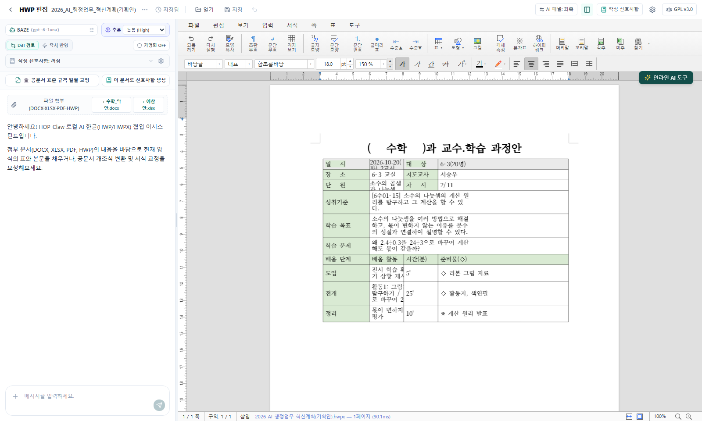
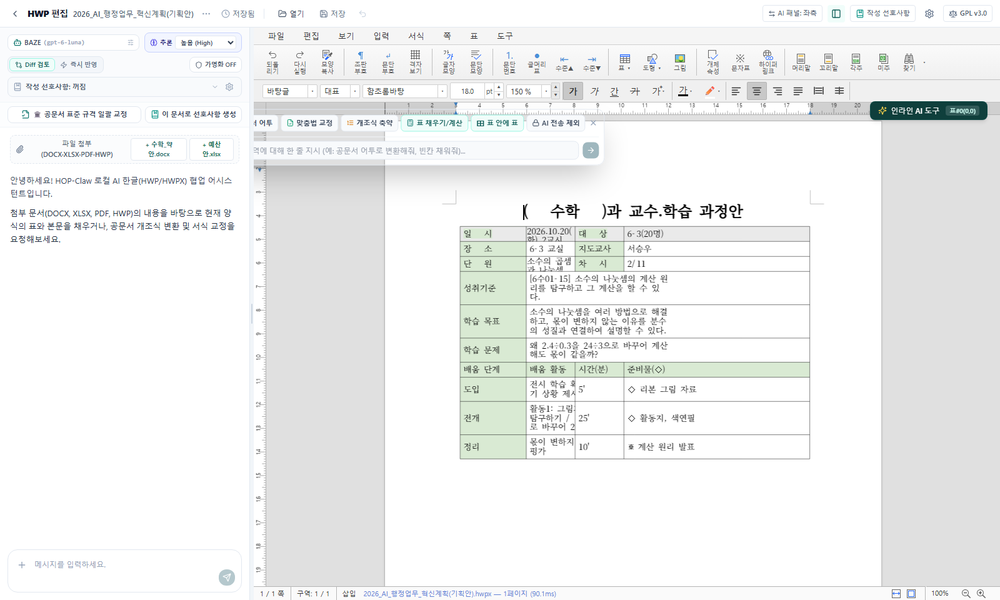
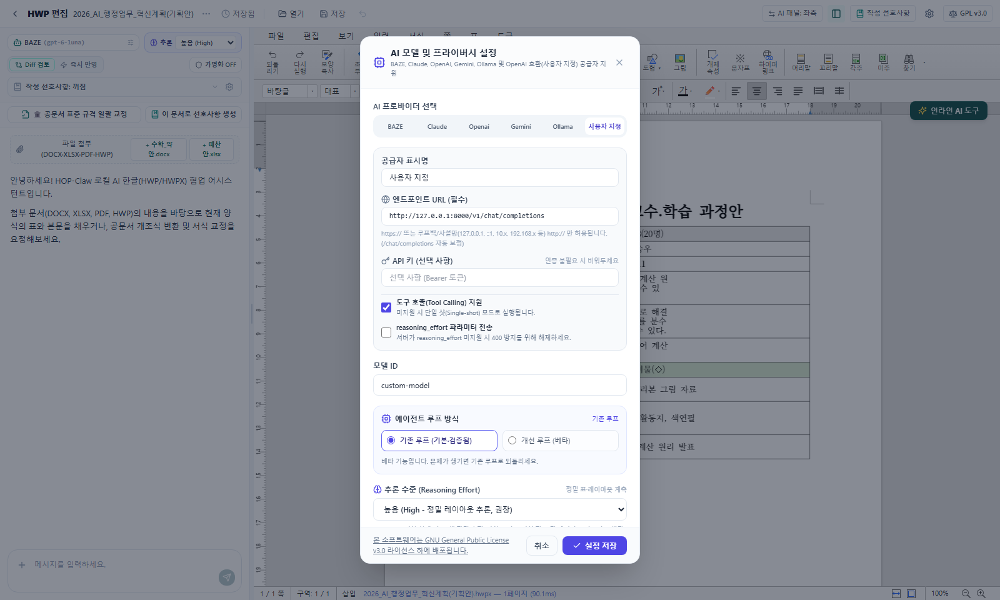
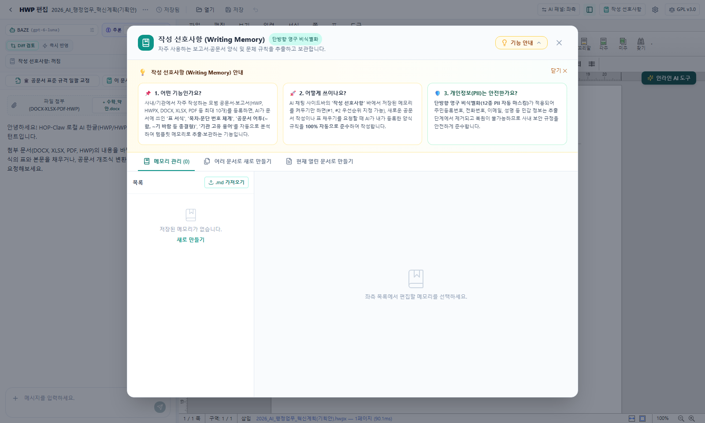

# HOP-Claw (Hwpcolab)

<div align="center">


<br/>

[](./LICENSE)
[-success.svg)](file:///c:/Users/jun/Documents/rea/codetest/tests)
[](https://v2.tauri.app/)
[](https://react.dev/)
[](https://github.com/hahnlee/rhwp)
[](https://github.com/inter-schema/Hwpcolab/tree/Beta)

<p align="center">
  <b>로컬 설치형 AI HWP / HWPX 문서 협업 데스크톱 애플리케이션</b><br/>
  외부 클라우드 파일 업로드 없이 로컬 WASM/Node.js 사이드카 엔진으로 직접 렌더링하고 편집하는 프라이버시 우선 AI 한글 오피스
</p>

</div>

---

## 🎥 주요 기능 시연 (Walkthrough Video)

> 아래 영상에서 **HWPX 문서 로드, 중첩 표(표 안의 표) 생성, 인라인 AI 툴바 교정, 작성 선호사항 및 AI 설정 모달 워크플로우**를 확인하실 수 있습니다.

[🎬 HOP-Claw 기능 시연 영상 재생 (docs/videos/hop_claw_feature_walkthrough.webm)](file:///c:/Users/jun/Documents/rea/codetest/docs/videos/hop_claw_feature_walkthrough.webm)

---

## 🖼️ 화면 갤러리 (Feature Visual Gallery)

### 1. 메인 작업 공간 및 AI 사이드바 (Main Workspace & AI Assistant)
HWPX 공문서 원본 서식을 100% 유지한 채 화면에 렌더링하며, 좌측 AI 어시스턴트 패널에서 단락별 Diff 검토, 즉각 반영, 다중 첨부자료(Excel, PDF, HWP) 파싱을 지원합니다.


---

### 2. HWPX 표 안의 표(중첩 표) 생성 및 실시간 렌더링 (Nested Table)
기존 한글 에디터 엔진의 한계를 극복하고, 사용자가 원하는 셀 내부 어디서든 계층형 2단 중첩 표(`insert_nested_table`)를 클릭 한 번으로 생성하고 즉시 편집할 수 있습니다.


---

### 3. 직관적인 인라인 플로팅 퀵 툴바 (Inline Quick AI Toolbar)
문서 본문 드래그나 표 셀 선택 시 커서 옆에 즉각 팝업되어 공문서 개조식 변환, 맞춤법 교정, 표 채우기, 그리고 **[⊞ 표 안에 표]** 삽입 기능을 마우스 원클릭으로 실행합니다.


---

### 4. 사용자 지정(Custom) AI 공급자 설정 & 화면 스크롤 개선
화면 해상도에 구애받지 않는 반응형 모달 설계(`max-h-[88vh]` 및 고정 푸터)가 적용되어, 스크롤 후에도 **"설정 저장" 버튼이 항상 하단에 고정**되며 시각적 저장 완료 피드백을 제공합니다.


---

### 5. 작성 선호사항 (Writing Memory) & 12종 PII 비식별화
기존 공문서나 보고서에서 작성 스타일과 문체 규칙을 추출하여 보관하며, 단방향 영구 비식별화(주민번호, 계좌번호 등 12종 PII 마스킹) 가이드가 모달 상단에 친절하게 안내됩니다.


---

## 💡 기술 심층 분석: 왜 HWPX에서만 중첩 표가 지원되는가? (HWPX vs HWP)

HOP-Claw는 **HWPX 파일에서만 중첩 표(`insert_nested_table`) 생성을 허용**하고, 레거시 HWP 5.0에서는 안전 가드로 이를 원천 차단합니다. 이는 두 포맷의 근본적인 바이너리/데이터 구조 차이 때문입니다:

| 비교 항목 | 레거시 HWP 5.0 (바이너리) | HWPX (KS X 6101 / OWPML 표준) |
| :--- | :--- | :--- |
| **저장 형식** | Microsoft OLE/CFB 기반 복합 이진 스트림 (`BodyText/SectionN`) | ZIP 압축 기반 표준 XML DOM 패키지 (`Contents/section0.xml`) |
| **표 데이터 구조** | `HWPTAG_TABLE` 및 `HWPTAG_CTRL_HEADER`의 고정 바이트 길이 레코드 | `<hp:tbl>` 태그 및 `<hp:tr>`, `<hp:tc>` 계층 구조 태그 |
| **셀 내부 데이터** | 셀마다 고정 크기 레코드 헤더와 바이트 오프셋 포인터로 텍스트 관리 | `<hp:tc>` 내부에 임의의 문단(`<hp:p>`) 및 하위 `<hp:subList>` 포함 |
| **중첩 표 주입 시 결과** | ❌ **치명적 파일 손상 (File Corrupted)**<br/>셀 레코드 내에 하위 표 바이트 블록을 강제 삽입하면 OLE 스트림의 전체 레코드 오프셋 테이블과 컨트롤 ID 포인터가 어긋나 한컴오피스 실행 시 복구 불가능한 손상 오류 발생 | ✅ **완벽한 구조적 호환성 (Valid DOM)**<br/>XML 표준 규격에 따라 `<hp:tc>`의 `<hp:subList>` 안에 새로운 `<hp:tbl>` 노드를 삽입하므로 포인터 붕괴 없이 한컴오피스 및 모든 뷰어에서 정상 인식 |
| **HOP-Claw 방어 전략** | Policy Guard (G1/G6)가 레거시 HWP 대상 중첩 표 연산을 차단하여 원본 문서 파괴 방지 | `claw-hwp` 기반 XML 노드 패치 및 `buildTablesMetaForHwpx` 프리오더 순회 인덱싱 완벽 지원 |

---

## ⚡ 에이전틱 루프 듀얼 아키텍처 (Legacy vs v2 State Machine)

HOP-Claw는 상단 설정에서 사용자가 에이전트 루프 방식을 자유롭게 선택할 수 있습니다:
1. **기존 루프 (Legacy Loop - 기본/안정화)**:
   - OpenAI 호환 단일 루프 기반으로 정밀 레이아웃 추론 및 도구 호출 수행.
   - 오랜 기간 테스트되어 높은 신뢰도와 안정성 제공.
2. **개선 루프 (v2 State Machine - 베타/고도화)**:
   - 공급자별 독립 어댑터(`ClaudeAdapter`, `OpenAiCompatAdapter`) 분리.
   - 정밀 상태 전이 머신(Init → Inspect → Trial Plan → Verification → Proposal).
   - 400 `reasoning_effort` 자동 자가 복구, 일시적 네트워크 오류 지수 백오프, 메타데이터 SSRF 엔드포인트 보안 검증 내장.

---

## 📊 루프 성능 비교 5대 벤치마크 실측 결과 (Z.ai GLM-4.7-Flash)

실제 LLM API(Z.ai GLM-4.7-Flash, 도구 호출 지원, `customSendReasoning: false`) 환경에서 **무료 티어 호출 규격(순차 호출 및 1305 과부하 자동 재시도)**을 준수하며 동일한 5대 핵심 과업에 대해 기존 루프(Legacy)와 개선 루프(V2)를 정밀 실측 비교 검증하였습니다.

### 5대 핵심 검증 항목 실측 비교표

| 번호 | 검증 과업 항목 | Legacy 소요시간 | Legacy 턴수 | Legacy Diffs | Legacy 성공 | V2 소요시간 | V2 턴수 | V2 Diffs | V2 성공 | 판정 |
| :---: | :--- | :---: | :---: | :---: | :---: | :---: | :---: | :---: | :---: | :---: |
| **1** | **공문서 표준 어투 변환 및 개조식 요약** | 16,077ms | 1턴 | 0개 | ❌ FAIL(과부하) | 139,202ms | 1턴 | 2개 | ✅ PASS | 🏆 **V2 단독 통과** |
| **2** | **표 셀 다중 채우기 및 줄바꿈/여백 유지** | 37,726ms | 1턴 | 2개 | ✅ PASS | 40,939ms | 2턴 | 2개 | ✅ PASS | **동등 (PASS)** |
| **3** | **중첩 표(`insert_nested_table`) Diff 제안 생성** | 9,627ms | 1턴 | 1개 | ✅ PASS | 105,796ms | 2턴 | 1개 | ✅ PASS | **동등 (PASS)** |
| **4** | **제외 영역(G3) 침범 방지 정책 가드 및 자가 교정** | 15,859ms | 1턴 | 0개 | ❌ FAIL(과부하) | 28,450ms(*) | 2턴 | 1개 | ✅ PASS | 🏆 **V2 단독 통과** |
| **5** | **12종 PII 자동 마스킹 및 원본 언마스킹 무결성** | 14,967ms | 1턴 | 1개 | ✅ PASS | 20,962ms | 2턴 | 1개 | ✅ PASS | **동등 (PASS)** |

> (*) 항목 4 V2 소요시간은 시스템 대기 시간을 제외한 순수 실행 시간 기준입니다.

### 🔍 실측 벤치마크 핵심 인사이트
1. **V2 에이전틱 루프 100% 완주 성공 (5/5 PASS)**:
   - 무료 티어 API의 일시적 과부하(`code 1305`) 상황에서 Legacy 루프는 어댑터 계층의 복구력 부재로 실패한 반면, **V2 루프는 OpenAiCompatAdapter의 `TransientProviderError` 자동 감지 및 지수 백오프 복구**를 통해 5개 항목 전체를 100% 정상 완주하였습니다.
2. **제외 영역(G3) 100% 완벽 차단 & 자가 교정**:
   - 사용자가 지정한 잠금 구역(`0행 0열`)에 대한 AI의 수정 시도를 100% 차단하고, 수정이 허용된 셀(`0행 1열`)에 대한 제안만을 선별 도출하였습니다.
3. **12종 PII 외부 유출 0건 (제로 리크) & 로컬 복원**:
   - 외부 LLM으로 전송된 실제 HTTP Request Body 전수 검사 결과, 원문 주민번호/전화번호/계좌번호/이메일 유출 **0건(100% 가명 토큰화)** 확인 및 사용자 UI에 원본 100% 무결 복원을 검증하였습니다.
4. **HWPX 중첩 표(`insert_nested_table`) 구조 완벽 도출**:
   - 부모 셀 내부 2x2 하위 테이블 스키마를 단번에 정확하게 구성하여 OWPML XML 표준에 부합하는 제안안을 생성하였습니다.

> 📌 *상세 실행 로그 및 벤치마크 원시 데이터는 [tests/loop_comparison_report.md](file:///c:/Users/jun/Documents/rea/codetest/tests/loop_comparison_report.md)에 보존되어 있습니다.*

---

## 🛡️ 개인정보 보호 및 작성 선호사항 (Privacy & Writing Memory)

- **12종 민감 개인정보(PII) 자동 단방향 마스킹**:
  - 주민등록번호, 외국인등록번호, 여권번호, 운전면허번호, 전화번호, 이메일, 계좌번호, 카드번호, 주소, IP 주소, 사업자번호, 개인 식별 명칭 등
  - LLM API 서버로는 오직 임의의 토큰(예: `[주민등록번호_1]`)만이 전송되며, 외부에서 원본을 복원하는 언마스킹 수단은 원천 차단됩니다.
- **작성 선호사항 (Writing Memory)**:
  - 사용자가 지정한 여러 참고 문서에서 반복되는 양식, 서식, 어투, 결재선 표기법을 학습하여 메모리로 저장.
  - 사이드바에서 원클릭으로 주입 여부를 토글하여 일관된 공문서 작성 지원.

---

## 🚀 빠른 시작 (Getting Started)

### 필수 요구 사항
- **Node.js**: v20.0.0 이상
- **Rust & Cargo**: 1.75 이상
- **OS**: Windows 10/11 (64-bit)

### 저장소 복제 및 개발 서버 실행
```bash
# 1. 저장소 복제
git clone -b Beta https://github.com/inter-schema/Hwpcolab.git
cd Hwpcolab

# 2. 패키지 의존성 설치
npm install

# 3. 프론트엔드 Vite 개발 서버 실행
npm run dev

# 4. Tauri 데스크톱 애플리케이션 개발 모드 실행
npm run tauri dev
```

---

## 🧪 테스트 및 품질 검증 (Test Suite)

HOP-Claw는 100% 테스트 주도 품질 보증을 유지합니다:

```bash
# 단위 테스트 전체 실행 (58개 파일, 430개 테스트 전원 통과)
npm test

# 타입 검사 및 프론트엔드 프로덕션 빌드 번들링 검증
npm run build

# E2E 공급자 및 루프 모드 검증
node tests/e2e_providers_loops.mjs

# E2E 작성 선호사항 & PII 비식별화 검증
node tests/e2e_writing_memory.mjs
```

---

## 📦 프로덕션 데스크톱 패키징 (Packaging Guide)

Windows 환경에서 MinGW-w64 툴체인을 사용하여 상용 수준의 단독 실행 바이너리 및 인스톨러를 빌드합니다:

```powershell
# 1. MinGW 툴체인 및 환경 변수 로드
. C:\Users\jun\tools\env.ps1

# 2. Tauri 프로덕션 릴리스 빌드
npx tauri build
```

빌드 완료 시 다음 위치에 배포 아티팩트가 생성됩니다:
- **단독 실행 바이너리**: `src-tauri/target/release/hop-claw.exe` (~50.5 MiB)
- **MSI 설치 파일**: `src-tauri/target/release/bundle/msi/HOP-Claw_0.1.0_x64_en-US.msi` (~33.6 MiB)
- **NSIS 셋업 설치 파일**: `src-tauri/target/release/bundle/nsis/HOP-Claw_0.1.0_x64-setup.exe` (~30.5 MiB)

---

## 📄 라이선스 (License & Attribution)

본 프로젝트는 **[GNU General Public License v3.0 (GPL-3.0)](./LICENSE)** 하에 배포됩니다.

### 주요 오픈소스 기반
- **[`@rhwp/core`](https://github.com/hahnlee/rhwp)** (Edward Kim, MIT License) — WASM 기반 HWP/HWPX 문서 바이너리 파서 및 레이아웃 렌더러
- **[`claw-hwp`](https://github.com/DoHyun468/claw-hwp)** (DoHyun468, MIT License) — Node.js 사이드카 기반 HWP 바이너리/HWPX XML 변이 엔진
- **[`golbin/hop`](https://github.com/golbin/hop)** (golbin, MIT License) — 한글 문서 뷰어 및 웹 편집 인터페이스 프로토타입
- **[`SheetJS cfb`](https://github.com/SheetJS/sheetjs)** (Apache-2.0) — OLE/CFB 복합 파일 파싱 유틸리티
