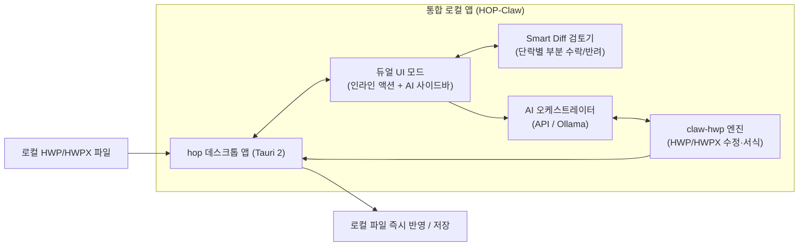

# 로컬 설치형 AI HWP 협업 앱 기능 명세서 (PRD)

## 1. 개요 및 핵심 가치 (Core Vision)
기존 웹/클라우드 기반 생성형 AI 문서 도구(예: aichat.cje.ac.kr, 한컴독스 등)는 파일을 서버에 업로드하고 다운로드해야 하는 절차적 번거로움과 공공·교육기관 특유의 데이터 유출 우려가 있습니다.

본 제품은 **오픈소스 데스크톱 HWP/HWPX 뷰어인 `golbin/hop`**과 **한컴오피스 무설치 HWP 조작 엔진인 `DoHyun468/claw-hwp`**를 결합하여, **"업로드가 전혀 필요 없고, 단 몇 번의 클릭만으로 로컬 문서와 AI가 협업하는 데스크톱 전용 앱"**을 목표로 합니다.

---

## 2. 핵심 UI/UX: 듀얼 인터랙션 모드 (Dual Mode)

사용자가 문서를 편집하는 흐름을 방해하지 않으면서 직관적인 AI 제어를 제공하기 위해 **인라인 퀵 액션**과 **대화형 사이드바**가 유기적으로 연동됩니다.

### 2.1 인라인 퀵 액션 (Inline Floating Action)
* **트리거**: 문서 내에서 마우스로 문장, 문단, 또는 **표의 셀들을 드래그(블록 지정)**하거나 우클릭할 때 커서 바로 위에 노션(Notion AI) 스타일의 플로팅 툴바가 팝업됩니다.
* **주요 원클릭 기능**:
  - `[공문서 어투 변환]`: 개조식 어미(~함, ~바람, ~조치 요망 등)로 즉시 교정
  - `[맞춤법 및 비문 다듬기]`: 문맥에 맞춘 자연스러운 문장 정제
  - `[요약 및 개조식 축약]`: 장문의 단락을 글머리 기호 번호 목록으로 축약
  - `[표 채우기 / 계산]`: 빈 셀 영역 드래그 시 문맥을 파악해 항목별 데이터 자동 기입
  - `[한 줄 즉시 요청]`: 선택된 영역에 대해서만 "더 격식 있게", "3줄로 줄여줘" 등 간결한 프롬프트 입력

### 2.2 대화형 사이드바 (Interactive Chat Sidebar)
* **트리거**: 화면 우측 상시 열림 또는 접이식(Collapsible) 패널.
* **주요 기능**:
  - **문서 전체 거시적 지시**: "문서 전체의 글꼴/자간을 공문서 표준 규격으로 일괄 변경해줘", "문서 끝에 결론 및 향후 계획 섹션을 추가해줘"
  - **신규 문서 생성**: 빈 화면에서 주제와 개요만 입력받아 완전한 HWP 문서 초안을 즉석 렌더링
  - **로컬 멀티 파일 참조 (Drag & Drop)**: 외부 참고자료(PDF, Excel, 다른 HWP, 이미지 등)를 사이드바에 던져 넣고 *"이 엑셀 표 데이터를 읽어서 현재 문서 2페이지 표에 채워줘"* 형태의 크로스 문서 작업 지원

---

## 3. 수정 검토 및 반영: 스마트 Diff & 부분 수락 (Smart Diff)

AI가 문서를 마음대로 덮어씌워 레이아웃을 망가뜨리는 문제를 방지합니다.

1. **시각적 변경 대비 (Visual Diff)**:
   - 변경/추가된 문장 및 표 셀은 녹색/파란색 하이라이트, 삭제된 부분은 취소선/붉은색으로 문서 뷰어 위에 인라인 오버레이 표시.
2. **단락/셀 단위 부분 수락 (Granular Accept/Reject)**:
   - 각 변경 단위 옆에 작은 `[✔ 적용]` / `[✖ 되돌리기]` 버튼이 노출되어, 마음에 드는 수정 사항만 골라서 반영 가능.
   - 전체를 한 번에 승인하는 `[모두 적용]` 버튼 제공.

---

## 4. 기능 지원 범위 (claw-hwp 기반 Scope)

`claw-hwp`가 보장하는 한컴오피스 무설치 HWP/HWPX 제어 역량을 100% 활용합니다:

* **문단 및 서식**: 글꼴, 글자 크기, 자간, 장평, 줄간격, 양쪽 정렬 등 디테일한 타이포그래피.
* **표(Table) 특화 제어**:
  - 표 생성, 행/열 추가·삭제
  - 셀 병합(Merge) 및 분할(Split)
  - 셀 배경색, 테두리 선 굵기 및 종류 설정
* **공문서 서식 규정 준수**:
  - 행정업무운영 편람에 맞춘 `1. -> 가. -> 1) -> 가) -> (1) -> (가)` 개조식 들여쓰기 및 번호 매기기 자동 교정.
* **개체 및 페이지 설정**:
  - 이미지(직인, 증빙사진, 다이어그램) 삽입.
  - 쪽 번호, 머리말/꼬리말, 각주, 다단 레이아웃 설정.

---

## 5. AI 엔진 및 데이터 보안 정책

* **하이브리드 LLM 지원**:
  - **상용 API**: Claude (Sonnet 3.5/3.7 권장 - 복잡한 표/서식 제어 툴콜링 최적화), OpenAI, Gemini API 키 등록 지원.
  - **로컬 LLM**: 완전 폐쇄망 및 100% 오프라인 구동을 위한 Ollama 로컬 엔드포인트 연동.
* **프라이버시 & 선택적 마스킹 (Non-intrusive Privacy)**:
  - 전송 과정에서 무조건 마스킹을 강제하지 않고, **사용자가 필요하다고 판단할 때만** 우클릭 메뉴(`[이 영역 AI 전송 제외]`)나 사이드바 토글을 통해 특정 개인정보(주민번호, 명단 등)를 가명화하거나 전송 대상에서 배제할 수 있는 부가 선택권 제공.

---

## 6. 기대 효과 (User Journey Comparison)

| 구분 | 기존 클라우드 AI 서비스 (예: aichat.cje.ac.kr 등) | 로컬 AI 협업 앱 (HOP + claw-hwp) |
| :--- | :--- | :--- |
| **작업 흐름** | 파일 찾기 ➔ 웹 업로드 ➔ AI 생성 대기 ➔ 다운로드 ➔ 한글로 열기 | **문서 더블클릭 ➔ 앱에서 바로 수정 ➔ 원클릭 완료** |
| **보안/망 분리** | 공문서 원본이 외부 클라우드 서버로 전송됨 | **문서 파일이 PC 외부로 유출되지 않음 (로컬 유지)** |
| **상호작용** | 전체 문서 재다운로드 위주 (부분 수정 어려움) | **원하는 문단/표만 드래그해서 즉시 부분 수정 & 스마트 Diff** |
| **소프트웨어 종속** | 한컴오피스 또는 특정 전용 뷰어 설치 필요 | **한컴 무설치 환경(Mac/Linux/Windows)에서도 완벽 지원** |

---

## 7. 아키텍처 및 구현 모듈
- **Tauri Rust 사이드카 (src-tauri/)**: claw_bridge를 통해 claw-hwp 로컬 엔진 실행
- **WASM 뷰어 (src/)**: @rhwp/core 엔진을 통한 브라우저/웹뷰 인메모리 렌더링
- **오케스트레이터 및 프라이버시 (src/services/, src/memory/)**: PII 자동 마스킹 및 LLM 에이전트 루프 관리
